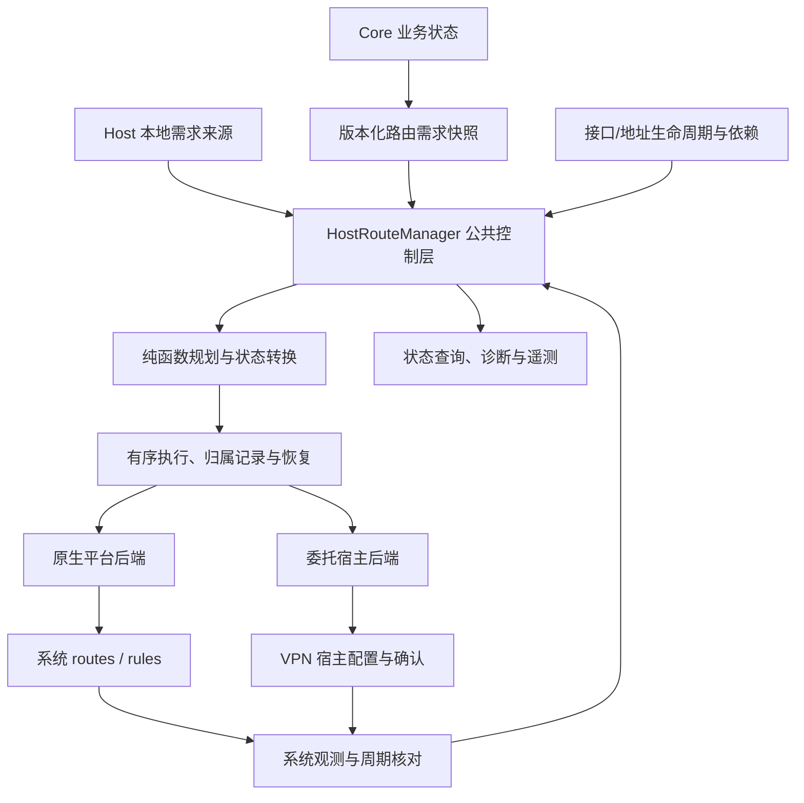

# HostRouteManager 实施总纲

状态：架构规划，尚未实施。本文固定目标、边界、实施顺序和验收门槛；每一步的接口、文件变更和测试用例在对应详细方案中展开。

基线：2026-10-03 检查的本地 `main` 为 `a017dc13`，当前工作区为 `feat/dns-policy` / `2569f35f`。实施 agent 必须重新确认目标分支和最新调用关系，不得覆盖其他工作。`refactor/route`、`refactor/route-dev` 只作历史参考，不作为迁移或兼容目标。

## 1. 目标与范围

建立跨平台的宿主路由控制子系统，使业务只提交路由需求，由统一的 HostRouteManager 管理归属、规划变更、执行、验证、重试、恢复和清理。最终删除新旧 ProxyCidrMonitor 及分散的宿主路由写入循环。

管理范围包括 EasyTier 显式安装的 IPv4/IPv6 路由、默认路由，以及所选平台策略需要的路由规则。覆盖自动代理路由、手工路由、接口前缀相关需求、public IPv6 和存在的 DNS/VPN 路由需求。具体来源以第一步全仓审计为准。

不接管 overlay 的 peer/下一跳选择，不重新实现 OSPF，不把 NIC 数据收发、DNS 服务、NDP、地址分配和所有系统网络设置塞进 Manager。地址、接口、外层连接保护等组件通过明确的依赖和生命周期协议协作；内核由地址派生的路由不自动认领为显式路由。

工作量不作为删减正确性要求的理由，但每个新增抽象都应服务于可说明、可验证的边界。

## 2. 不可妥协的正确性约束

1. **状态分离。** Desired 是最新有效需求；Observed 是有观测范围、完整性和新鲜度信息的系统快照；Owned 是归属证据；Pending 是执行中或结果不明的操作。四者不能互相冒充。
2. **单一写入权。** 同一受管理资源在一个时刻只有一个执行者。重试、配置变更、接口重建、退出清理不能绕过同一执行协调机制。
3. **失败不伪装成功。** 超时可能意味着已经生效，须核对；枚举失败不等于空表；不支持不等于成功；发现相同路由不等于拥有该路由。
4. **有条件的最终收敛。** 在需求稳定、必要资源可用、平台操作最终成功且外部不持续竞争的前提下，系统无需依赖下一次业务变化即可收敛。外部持续干预时报告冲突并限制重试，不无限争抢。
5. **保守的删除边界。** 只清理由本作用域拥有且仍符合删除条件的资源；不能凭 CIDR、接口名或旧缓存粗略删除，也不能清空整个共享表。
6. **过期工作不能覆盖新状态。** 来源 epoch/revision、接口代际、执行 operation ID 各自承担不同职责。旧回调不能推进新版本状态；其实际副作用仍须核对、跟踪和清理，不能简单忽略。
7. **快照是事实，通知是提示。** 初次订阅不能漏掉快照与订阅之间的变化；丢通知、任务重启和观察连接重建后可重新获取完整状态。
8. **有明确的完成定义。** 接受需求、平台确认应用、读回验证、冲突、降级、失败和清理未完成分别可查询。等待某个版本收敛时，版本被替代也应返回明确结果。

不得承诺各平台都不具备的事务或所有权能力。在共享路由表上，如果第三方删除并重建完全相同的条目，缺乏独有标识/原子条件删除的平台无法证明其身份未变。设计必须陈述协作假设，提供独占资源作用域、明确接管和冲突处理策略；持久化记录不能抹掉这种歧义。

## 3. 目标架构

### 3.1 Core 只提供业务需求

提供独立、类型明确的路由需求接口，不通过 Host 深入 PeerManager，不把宿主路由管理继续绑定在 packet-plane 的 diff 方法上。Core 不持有系统表号、接口索引、操作系统句柄或归属日志。

来源表达逻辑目标、用途和必要的业务策略。手工路由覆盖关系、默认出口选择等必须在确定的一层解析，不能由桌面 Rust 和移动端 UI 分别推导。Core 来源与 Host 来源都通过同一种注册/更新/撤销协议进入控制层。

每个来源提交完整快照。来源有稳定身份与生命周期 epoch，每个 epoch 内 revision 单调递增。撤销保留拒绝旧消息所需的信息；来源异常、暂不可读和明确的空需求不能混同。多来源存在依赖时支持一致版本批次或显式依赖屏障。

### 3.2 公共控制层统一归属和调度

按实际宿主路由域组织协调器，同一进程内的多个 EasyTier 实例注册独立作用域/句柄，避免各自独立判断同一个资源。互不相交的域可独立运行，不能用一个全局锁阻塞所有实例。

路由域由平台定义：例如系统网络栈/网络命名空间或受宿主控制的 VPN 会话，不能简单等同于表号。跨进程通过资源作用域的互斥/租约防止同时接管；不能依靠进程内单写者解决跨进程竞争。

控制层维护来源状态、需求来源关系、平台规范化后的路由身份、归属证据、观测缓存、待执行操作和对外状态。一个来源撤销不能删除其他来源仍需要的同一资源；不兼容需求必须按明确策略处理，不能依赖消息先后顺序决定结果。

NIC 生命周期组件负责设备和地址，向 Manager 提供带代际的绑定与依赖就绪状态。Manager 不通过 `Any`/downcast 读取 Nic 内部，也不随每次 TUN 重建丢掉需求和未完成清理记录。

### 3.3 规划、执行和平台能力分开

公共规划器使用规范化状态生成有前置条件和依赖顺序的计划；执行器处理平台操作、超时、重试、持久化和读回；平台适配器封装系统差异。公共层不得直接使用某个平台的字段推断归属。

后端需要同时表达两类能力：

- 原生后端：枚举、精确定位、增删/可用的替换能力、变化通知或轮询、读回验证。
- 委托后端：提交完整配置版本，由外部 VPN 宿主应用并返回对应会话和版本的结果，必要时重新建立会话。不能强迫它模拟逐条原生路由操作。

能力契约明确地址族、作用域、可观测性、删除精度、变更粒度和确认强度。未知字段不能错误地视为相等；未知条目不能转成可安全删除的自有条目。实际删除所需的系统身份可以由不透明后端句柄承载。

系统调用成功、宿主确认应用和实际读回验证是不同证据。平台无法枚举时，报告宿主确认级别；连应用确认都做不到时，报告不可验证，不能声称已经核对系统状态。

### 3.4 归属与崩溃恢复

所有平台采用同一归属状态机。记录资源作用域、实例/接口代际、规范化配置、创建证据、操作状态和恢复版本。平台可用的额外标记只是辅助证据；不要求所有平台支持 protocol，也不以 protocol 作为公共架构前提。

区分自有资源、外部资源满足需求、明确接管的资源和归属不明资源。共享表上仅靠“路由恰好存在”不得自动认领。已有条目是否可满足需求也要按策略和规范化属性判断，不能只比较前缀。

需要跨进程重启恢复的状态使用可恢复日志/检查点，定义写入顺序、版本兼容、损坏处理及磁盘失败行为。记录操作意图与结果，但承认“系统修改成功、结果尚未落盘就崩溃”的不确定窗口，恢复时结合实际状态与作用域证据判定，不能盲目接管或删除。

退出是有截止时间、可查询结果的显式协议。不能把异步清理寄托于 Drop，也不能无限等待或静默丢弃失败清理；未完成项进入恢复流程。

### 3.5 专用路由表是策略能力

基础跨平台行为不依赖专用表。Linux 专用表及相关规则由同一个 Manager 管理，使用相同归属、计划、观测和恢复机制；不再实现第二套路由管理器。

“使用系统共享表”和“使用专用表”的路由优先级语义必须分别定义。专用表上线前验证本地 LAN、默认出口、多个实例、现存策略路由和外层连接绕行。不因为完成隔离就静默改变选路行为。

## 4. 分步实施计划

步骤号固定，便于逐步展开详细方案。各步包含自己的验证，不把测试全部留到最后；未完成某个平台或契约时，不得以空实现宣布整步完成。

### 第一步：冻结行为契约和平台能力矩阵

**工作：** 审计所有路由来源、直接系统写入点、事件消费者、移动端配置链和配置语义。定义资源作用域、接管策略、冲突规则、来源/接口生命周期、完成状态和安全边界。明确支持平台及每个平台的原生、委托或不支持能力。记录桌面与移动端当前行为差异，决定哪些兼容、哪些作为有说明的修复。

**产物：** 行为与能力矩阵、路由来源/写入者清单、架构契约、迁移映射和故障场景目录。模块/包位置根据 core/native 分层确定，不能从旧分支目录倒推架构。

**验收：** 每种现有路由都能回答“谁需要、谁写、谁拥有、如何撤销、失败如何报告”；特别覆盖 `manual_routes = None` 与显式空集合、public IPv6 默认路由、DNS、无 TUN 和宿主管理 TUN。

### 第二步：建立版本化路由需求接口

**工作：** 实现 Core 路由需求投影及 Host 来源注册协议，发布一致快照并提供无丢更新窗口的订阅。实现来源 epoch/revision、撤销语义、重新订阅和初始状态获取。把业务覆盖策略放在唯一确定的位置，业务变化驱动发布；不能把旧的一秒 CIDR 轮询改名为新组件。

**产物：** 类型化需求模型、快照/订阅接口、各来源适配器及版本协议测试。此阶段不启用新的系统写入者；旧链路继续承担实际写入。

**验收：** 订阅竞态、撤销后迟到消息、来源重启、配置更新、peer 路由变化和不同来源合并均有明确结果；读取需求不依赖旧 monitor 是否启用。

### 第三步：实现公共模型、纯规划器和归属状态机

**工作：** 实现 Desired/Observed/Owned/Pending、路由身份与平台规范化契约、归属转换、多来源合并/冲突处理及计划依赖。设计恢复日志接口和故障语义，用模拟后端驱动模型，不依赖真实系统权限。

**产物：** 可独立测试的规划与状态转换模块、模拟时钟/后端、状态序列和故障注入测试。归属规则应显式区分 Created、AlreadyExists、结果未知等情形，不能从通用 `Ok(())` 推断。

**验收：** 幂等、失败不推进成功状态、外部相同路由不自动认领、重复需求不重复删除、过期版本不复活、观测失败不清空、未知结果先核对后重试等不变量成立。关键并发与崩溃窗口用模型化序列覆盖。

### 第四步：实现平台后端及契约测试

**工作：** 基于当前主线后端实现可靠枚举、规范化、操作结果分类、精确删除/替换、变化监听和全量扫描；原生平台优先采用结构化系统接口。Linux namespace 操作须有正确的执行线程/句柄归属，不能在可迁移异步任务中跨 await 持有线程级 namespace 切换。为移动端/其他委托宿主实现带会话和版本的配置提交、结果回读协议。

**产物：** Linux、Windows、macOS/FreeBSD 等实际支持的原生适配器，Android/其他已支持 VPN 宿主适配器，明确的 no-TUN/不支持实现，以及统一后端契约测试。具体平台范围由第一步确定，未支持的平台不得声称已完成适配。

**验收：** 平台真实环境验证枚举完整性、默认值规范化、精确删除、外部修改、通知丢失和结果未知；只交叉编译通过不能替代平台行为测试。无法观测或精确操作的能力必须显式呈现。

### 第五步：实现执行运行时、自愈和恢复

**工作：** 实现每个路由域的协调器、实例作用域、单写者执行、周期核对、事件唤醒、退避重试和公平调度。接入日志/检查点、跨进程资源接管约束、接口代际、恢复和显式 shutdown。实现可按版本等待的状态查询及诊断。

**产物：** 可运行的 HostRouteManager 服务及实例句柄；完成意图、操作、验证和恢复闭环。平台调用不持有阻塞其他来源发布所需的锁；慢操作和取消都按结果可能未知处理。

**验收：** 没有新的业务事件仍能重试；外部删除可修复；持续冲突不会忙循环；接口重建时旧操作副作用能被回收；任一持久化/系统操作边界崩溃后恢复不越过归属边界；退出失败可报告和后续恢复。

### 第六步：接入所有来源和宿主生命周期，切换唯一写入者

**工作：** 接入现有 NativeInstanceRuntimeHost/TUN 生命周期、自动/手工路由、IPv6 默认出口及实际存在的 DNS/VPN 来源。地址组件与 Manager 协调依赖顺序。移动端消费统一需求快照，不再在 UI 重新合并另一套路由语义。观测 IPv6 provider 等宿主路由读取者，避免把自己新装的路由当成物理上游造成反馈。

**产物：** 各入口集成、带版本的就绪/重建/停止协议、旧资源迁移策略。先做只读计划对比，再逐作用域执行明确的写入权交接；不允许新旧组件同时写同一资源。

**验收：** 静态地址、DHCP、TUN 重建、配置热更新、多实例、移动 VPN 重建和迟到确认均通过端到端验证。旧路由无法证明归属时按既定策略处理，不能批量认领。功能退出不再留下未登记的后台路由写入者。

### 第七步：实现专用表及明确的选路策略

**工作：** 在后端能力允许的平台加入专用路由表/规则策略，完成表号和规则优先级的冲突管理、外层流量绕行、接口自动前缀路由协调、IPv4/IPv6 对等支持，以及安装/撤销依赖顺序。定义 fail-open/fail-closed 的适用范围和故障行为，不默认承诺断网保护或无缝原子切换。

**产物：** 共享表与专用表的策略实现、配置与迁移说明、跨表优先级及多实例测试。它们共用公共 Manager，不另起平台专用控制循环。

**验收：** 测试实际包路径，覆盖本地 LAN 与代理前缀重叠、默认路由、隧道 peer/DNS/打洞/FakeTCP 等外层路径、其他 VPN 和两个 EasyTier 实例。专用表不会仅因“看起来更干净”就成为未经验证的新默认。

### 第八步：删除旧机制并完成发布验收

**工作：** 删除两个 monitor、旧 diff 控制链、NicCtx 中分散的路由更新任务和重复来源推导。收敛 Cargo feature、CoreEvent/GlobalCtxEvent、GUI/SDK/WASI 映射、日志和文档；需要兼容的事件只能从新状态派生用于通知，不再作为控制链唯一事实来源。

**产物：** 单一架构、完整平台验证报告、操作诊断文档和升级/恢复说明。明确验证过的平台、尚未验证的项和平台固有限制。

**验收：** 全仓检查确认全部受管理路由经由新系统；故障注入、多实例压力、持续配置变化、休眠/恢复和崩溃恢复通过。CI 覆盖实际支持的 feature/目标组合；无真实平台验证的关键能力不得标记为已验收。

## 5. 全程必须保留的验证主线

| 维度 | 必须验证的行为 |
| --- | --- |
| 业务语义 | 自动/手工路由、空配置、来源覆盖、重复来源、IPv4/IPv6、默认路由 |
| 归属 | 外部预存、属性不同、外部替换、自有资源撤销、明确接管与拒绝接管 |
| 通知与版本 | 丢失、重复、乱序、订阅竞态、来源重启、撤销后的迟到更新 |
| 操作失败 | 添加/删除失败、部分成功、超时但实际生效、枚举失败或不完整、持久化失败 |
| 生命周期 | 无接口、重建、同名接口/索引复用、停止中更新、迟到系统结果 |
| 并发与恢复 | 多实例、多个进程、交接、崩溃窗口、日志损坏、清理失败 |
| 平台差异 | 原生逐条操作、委托整批重建、确认强度、不支持能力与 no-TUN |
| 真实网络 | LAN 重叠、默认出口、外层绕行、其他 VPN、转发流量、IPv6 provider 反馈 |

这些测试验证对外不变量和故障结果，不以逐行复刻实现作为覆盖率目标。周期核对要测收敛上限、空闲开销和事件风暴下的公平性；不预先承诺没有测量依据的固定性能数字。

## 6. 对实施 agent 的约束

- 先完成当前步骤的详细方案和验收，再推进依赖它的步骤；中间提交保持可构建，生产写入切换在第六步发生。
- 可以复用主线可靠的系统操作代码；不为迁就 `route-dev` 保留旧容器、downcast、全局静态 configurator 或大规模 NIC 搬迁。
- 不假设所有桌面、移动端和嵌入式宿主具备相同系统权限。平台能力缺失必须回到契约处理，禁止 dummy 成功。
- 同一用户配置和业务状态只在一个确定位置解释；来源协议、平台规范化和选路策略分别负责各自语义。
- 行为修复与架构搬迁分别记录。现有平台差异需要显式决策，不能不知不觉改变手工路由覆盖或网络优先级。
- 需要操作真实宿主网络的验证使用隔离环境，避免测试改变开发机或其他实例的路由。
- 归属不能确定、快照不完整或能力不足时，保留可诊断的不确定状态；不能为了“收敛率”扩大删除范围。
