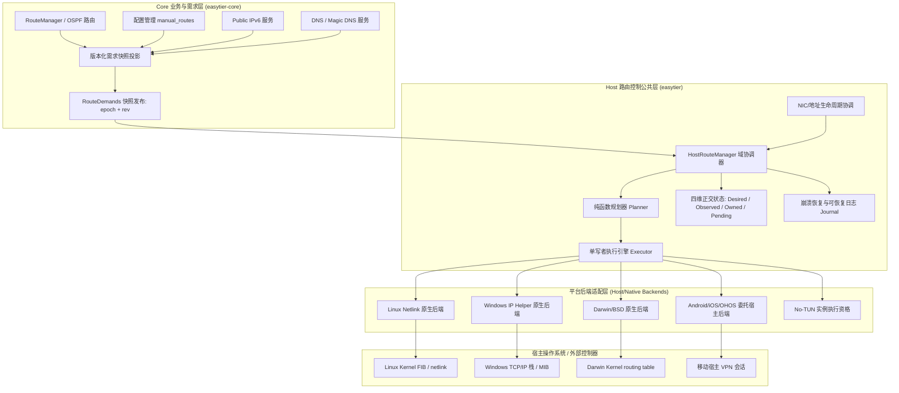
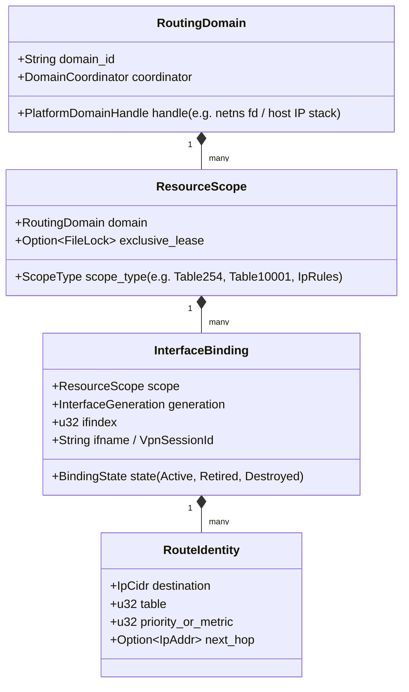
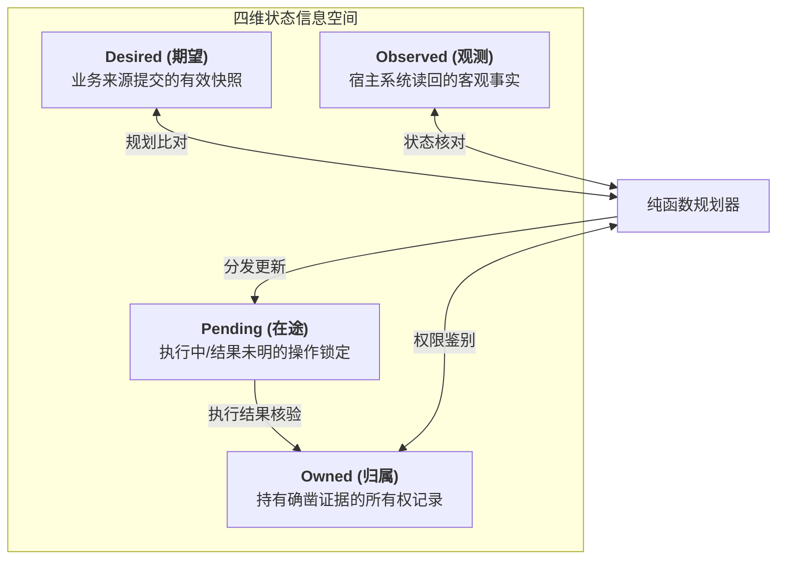
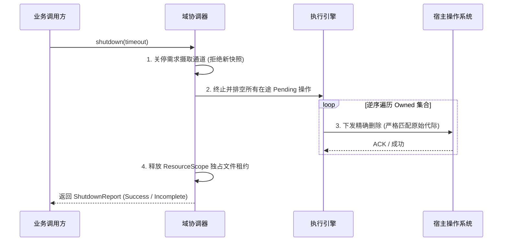

# HostRouteManager 第一步：行为契约、路由审计与平台能力矩阵（修订版）

状态：已根据审查意见（[`docs/host-route-manager-step1-review.md`](host-route-manager-step1-review.md)）完成深度修订；核心架构契约已修复并补齐，进入第二步实施前的准入核对状态。  
依据：《[HostRouteManager 实施总纲](host-route-manager-master-plan.md)》第一步要求。  
基线代码：本地 `main` 分支 `a017dc13`；涉及 DNS 需求部分对照 `feat/dns-policy` (`2569f35f`)；移动端对照 `tauri-plugin-vpnservice`、`easytier-gui` 及 `easytier-ohrs` 全仓审计。文档内所有文件链接均采用相对路径，关键结论附带具体源码文件与行号。

---

## 1. 概述与分层定位

本文档是 HostRouteManager 第一步的核心交付物。本次修订彻底纠正了初稿中对 `manual_routes` 作用域的过度夸大、概念实体的合并混淆、归属认领的非授权假设、接口代际清理的逻辑死锁，并重构了平台能力矩阵，补齐了需求生命周期与完成状态契约。

### 1.1 架构分层定位 (Core vs Host/Native)

根据实施总纲要求，子系统严格按照 **Core（业务与需求抽象，位于 `easytier-core`）** 与 **Host/Native（宿主控制与平台适配，位于 `easytier`）** 分层。杜绝从历史分支（如 `refactor/route-dev`）倒推引入全局静态单例、容器 downcast 或将 NIC 内部侵入路由控制的旧设计。

---

## 2. 路由来源、系统写入者与事件消费者全景审计

### 2.1 路由分类全景审计清单

对全仓代码进行静态审计，明确每种路由「谁需要、谁写、谁拥有、如何撤销、失败如何报告」：

| 路由类别 | 需求来源 (Who Needs) | 当前直接写入点 (Who Writes) | 当前归属 (Who Owns) | 如何撤销 (How Revoked) | 失败如何报告 (Failure Reporting) |
| :--- | :--- | :--- | :--- | :--- | :--- |
| **自动子网代理路由** `Peer Proxy CIDR` | 对端 Peer 广播自身代理的网段 (`proxy_cidrs`)，宿主需将流量导向 TUN 设备 | **桌面：** `ProxyCidrMonitor` (1s 轮询) -> `VirtualNic::run_proxy_cidrs_route_updater` -> `IfConfiger::add_ipv4_route` **移动：** `mobile_vpn.ts` 轮询 RPC -> `TauriVpnService.kt` `builder.addRoute` | **无**（直接注入 OS 共享主表或 VPN Session，无归属凭据） | **桌面：** 内存快照做 diff 后调 `remove_ipv4_route`；进程崩溃时泄漏 **移动：** 全量重启 VPN Session | **桌面：** 仅 `tracing::trace!` 记录 **移动：** 前端 catch 后 `console.error` |
| **手工静态路由** `manual_routes` | 用户在配置中显式指定的 CIDR 网段（仅作用于 proxy CIDR 需求集） | **桌面：** 同上（在 `ProxyCidrMonitor::resolve_proxy_cidrs` 中覆盖 peer 路由） **移动：** `mobile_vpn.ts` 前端并集拼装后传给 VPN | **无** | 同自动子网代理路由 | 同自动子网代理路由 |
| **接口直连网段路由** `Link Subnet Route` | TUN 网卡分配 IP 与子网掩码（如 `10.144.144.1/24`）时，由内核网络栈派生的链路前缀 | **Linux/Windows：** `VirtualNic::assign_ipv4_to_tun_device` 添加 IP 时由内核栈自动生成 **移动端：** `builder.addAddress` | **内核/系统栈派生** | 随 IP 移除或网卡销毁由内核自动收回 | 添加 IP 失败抛出错误；内核派生过程无显式报告 |
| **平台显式接口前缀路由** `Explicit Prefix Route` | **macOS / FreeBSD** 平台特性：内核不自动为 TUN 派生子网路由，必须显式安装 | **macOS/FreeBSD：** [`VirtualNic::assign_ipv4_to_tun_device`](../easytier/src/instance/virtual_nic.rs#L839-L846) 显式调用 `nic.add_route`；[`assign_ipv6_to_tun_device`](../easytier/src/instance/virtual_nic.rs#L856-L863) 显式调用 `nic.add_ipv6_route` | **无**（目前由 NIC 代码显式写入系统路由表） | 仅在网卡被关闭或 IP 移除时清理；若崩溃则残留 | 失败向上返回 `Result<(), Error>`，阻断网卡就绪流程 |
| **Public IPv6 默认路由** `::/0` | 开启 public-ipv6 时，分配到的公网 IPv6 前缀出口，用于导入公网流量 | [`VirtualNic::run_public_ipv6_addr_updater`](../easytier/src/instance/virtual_nic.rs#L1181-L1186) -> `nic.add_ipv6_route_with_cost(::, 0, Some(5))` | **无** | 监听到地址变化时调 `nic.remove_ipv6_route(::, 0)`；崩溃则泄漏 | 仅 `tracing::warn!` 记录日志 |
| **Public IPv6 对等节点路由** `Public IPv6 Routes` | 组网内其他节点声明的 Public IPv6 路由条目 | [`VirtualNic::run_public_ipv6_route_updater`](../easytier/src/instance/virtual_nic.rs#L1150) -> `ifcfg.add_ipv6_route` | **无** | 接收事件 diff 后调 `remove_ipv6_route` | 仅 `tracing::trace!` 记录日志 |
| **Magic DNS 虚拟 IP 路由** `fake_ip/32` | Magic DNS 分配的虚拟 IP（如 `7.7.7.7`）不在 TUN 子网内时需导入 TUN | **主线桌面：** [`MagicDnsServerInstance::new`](../easytier/src/instance/dns_server/server_instance.rs#L385-L388) 临时实例化 `IfConfiger{}` 写入 **移动：** `mobile_vpn.ts` 在启用时追加 `100.100.100.101/32` **feat/dns-policy：** `ProxyCidrsMonitor` 读取 `dns.addresses()` 注入 | **无** | **主线桌面：** `MagicDnsServerInstance::clean_env` 主动调用删除（Drop 中不执行，非正常退出泄漏） | 启动失败返回 `anyhow::Result` |
| **macOS 历史残留清理** `10.0.0.0/24` | `rust-tun` 库在 macOS/FreeBSD 创建网卡时默认注入的死路由 | [`VirtualNic::run`](../easytier/src/instance/virtual_nic.rs#L1256-L1260) -> `nic.ifcfg.remove_ipv4_route("10.0.0.0", 24)` | **无** | 仅开机单次显式删除 | 忽略错误 `let _ = ...` |

### 2.2 现有系统写入点代码审计

1. **`easytier/src/instance/virtual_nic.rs`**：
   - 内部包含 3 个由 `tasks: JoinSet` 托管的长期 updater 任务：
     - `run_proxy_cidrs_route_updater`（[Line 1048](../easytier/src/instance/virtual_nic.rs#L1048)）：监听 `GlobalCtxEvent::ProxyCidrsUpdated`。
     - `run_public_ipv6_route_updater`（[Line 1118](../easytier/src/instance/virtual_nic.rs#L1118)）：监听 `GlobalCtxEvent::PublicIpv6RoutesUpdated`。
     - `run_public_ipv6_addr_updater`（[Line 1171](../easytier/src/instance/virtual_nic.rs#L1171)）：监听 `GlobalCtxEvent::PublicIpv6Changed`。
   - 以及 2 个辅助路由应用函数：`apply_route_changes` 和 `apply_public_ipv6_route_changes`。
   - **关键缺陷分析**：
     - **错误推进缓存**：以 `apply_route_changes` 为例（[Line 997](../easytier/src/instance/virtual_nic.rs#L997)），无论底层 `ifcfg.add_ipv4_route` 返回成功或失败（甚至仅打 trace 日志），代码均执行 `cur_proxy_cidrs.insert(cidr)`。这意味着添加失败后，本地缓存仍假定其已存在，永久丧失重试机会。
     - **缺乏系统核对**：完全依赖内存中的 `cur_proxy_cidrs`。若系统路由被外部工具篡改或删除，代码无法自愈。
     - **清理缺乏生命周期协议**：销毁时依赖 `tasks.shutdown()` 强杀，无序且无确定性等待，无法保证已装路由被完全撤回。
   - **资源泄漏的真实边界**：临时 TUN 设备在被进程关闭或崩溃退出时，内核通常会自动清理绑定在 TUN 上的接口直连路由及以其为出口的路由；但若是持久网卡、命名空间残留对象、外部会话或未来加入的专用路由表规则（IP rules），则会产生持久泄漏。

2. **`easytier/src/instance/dns_server/server_instance.rs`**：
   - `MagicDnsServerInstance::new`（[Line 385–388](../easytier/src/instance/dns_server/server_instance.rs#L385-L388)）在 `fake_ip` 不属于 `tun_inet` 时调用 `ifcfg.add_ipv4_route`。
   - **NetNS 作用域隐患**：该调用直接使用全局默认的 `IfConfiger {}`，**完全未持有 `NetNSGuard`**。在实例运行于独立 netns 且当前线程未处于该 netns 的场景下，会导致系统调用在错误的命名空间执行，发生路由污染或添加失败。
   - **清理隐患**：清理代码仅存在于 `clean_env`（[Line 444](../easytier/src/instance/dns_server/server_instance.rs#L444)），`Drop` 实现中并未触发清理，异常退出必漏。

3. **`easytier/src/instance/virtual_nic.rs:833 & 850` (macOS / FreeBSD 显式前缀路由)**：
   - 在 macOS 和 FreeBSD 平台上，调用 `assign_ipv4_to_tun_device` 和 `assign_ipv6_to_tun_device` 分别显式调用了 `nic.add_route` 和 `nic.add_ipv6_route`。
   - **迁移阻断隐患**：若将接口前缀路由错误地一概视作“内核派生直连”而不纳入 HostRouteManager 显式需求，在重构/解耦 NIC 与路由管理后，macOS/FreeBSD 将丢失最基础的虚拟子网连通性。

### 2.3 独立的事件消费者全景清单

路由变更事件不仅供底层网络栈使用，还被全仓多个组件消费，重构时必须保障通知接口的兼容映射：

1. **`CoreEventSink` (`easytier-core/src/events.rs`)**：
   - 事件：`CoreEvent::ProxyCidrsUpdated { added, removed }`、`CoreEvent::PublicIpv6RoutesChanged`、`CoreEvent::PublicIpv6Changed`。
   - 消费者：Core 内置的事件发布通道，桥接至各外部宿主。
2. **`GlobalCtxEvent` 广播总线 (`easytier/src/common/global_ctx.rs`)**：
   - 事件：`GlobalCtxEvent::ProxyCidrsUpdated`、`GlobalCtxEvent::PublicIpv6RoutesUpdated`、`GlobalCtxEvent::PublicIpv6Changed`。
   - 消费者：
     - `VirtualNic` 中的 3 个 updater 任务。
     - CLI 事件日志器 [`easytier/src/instance/cli_event_logger.rs:216`](../easytier/src/instance/cli_event_logger.rs#L216)：格式化打印路由添加/移除日志。
     - Tauri 运行时 [`easytier-gui/src-tauri/src/lib.rs:1116`](../easytier-gui/src-tauri/src/lib.rs#L1116)：将事件序列化并转发给前端。
3. **前端 GUI 监听器 (`easytier-gui/src/composables/event.ts`)**：
   - 监听 `EVENTS.PROXY_CIDRS_UPDATED`（[Line 88](../easytier-gui/src/composables/event.ts#L88)），触发界面网络拓扑刷新与通知。
4. **Android / Tauri 插件桥接 (`easytier-gui/src/composables/mobile_vpn.ts`)**：
   - 监听宿主服务状态，虽不直接消费 `ProxyCidrsUpdated`，但在轮询 `collectNetworkInfo` 时读取 `routes` 变化并触发全量 VPN 重建。
5. **WASI 适配器 (`easytier-core/src/wasi/adapter/event.rs:52`)**：
   - 将 `CoreEvent::ProxyCidrsUpdated` 序列化为 `"proxy_cidrs_updated"` 字符串供 WebAssembly 宿主查询。
6. **Public IPv6 Provider 观察链 (`easytier/src/instance/public_ipv6_provider/linux.rs`)**：
   - [Line 338](../easytier/src/instance/public_ipv6_provider/linux.rs#L338)：调用 `list_ipv6_route_messages` 扫描系统默认路由以发现 WAN 上行接口。
   - [Line 115](../easytier/src/instance/public_ipv6_provider/linux.rs#L115)：通过 `collect_public_ipv6_tun_routes` 观察 TUN 设备上的 public IPv6 路由，以驱动 NDP Proxy 同步。

---

## 3. 配置项精确作用域与桌面/移动端行为决策

### 3.1 `manual_routes` 作用域的精确界定

针对审查意见 R1，在此严格规定 `manual_routes`（配置键 `services.manual_routes` / CLI `--manual-routes` / 配置项 `routes`）的生效边界：

1. **唯一作用域**：`manual_routes` **仅且仅覆盖「对端子网代理路由 (Peer Proxy CIDR)」这一单一来源**。
2. **独立性保证**：
   - **不影响本机代理发布**：本机是否向网络中其他节点通告子网代理（配置项 `proxy_cidrs`），完全由 PeerManager 广播逻辑决定，不受 `manual_routes` 影响。
   - **不影响报文转发**：内核或 TUN 的报文转发与 NAT 行为由转发配置控制。
   - **不影响其他路由来源**：接口直连/前缀路由、Magic DNS `/32` 路由、Public IPv6 默认路由 (`::/0`) 以及 Public IPv6 peer 路由各自拥有独立的生命周期和计算规则，**绝对不受 `manual_routes` 任何值的影响**。
3. **配置取值语义严格冻结**：
   - `manual_routes = None`：**自动跟随模式**。Proxy CIDR 需求集由 Core 动态收集并发布所有合法的对端 proxy CIDRs。
   - `manual_routes = Some([])`（显式空集合）：**代理路由禁用模式**。用户明确要求本机不路由到任何对端子网。此时 Proxy CIDR 需求集结果为**空集合**，彻底抑制对端代理路由；但其他独立来源（DNS、IPv6、接口路由）照常工作。
   - `manual_routes = Some([A, B])`（非空集合）：**静态覆盖模式**。Proxy CIDR 需求集结果严格为 `[A, B]`，所有对端代理路由被覆盖抑制。

### 3.2 验收反例：多来源共存矩阵

当系统中同时启用自动代理、手工路由、Magic DNS、接口前缀和 Public IPv6 时，不同 `manual_routes` 配置下的期望路由输出如下表所示：

| 配置场景 | Proxy CIDR 需求集 | 接口前缀需求集 (IPv4/IPv6) | Magic DNS `/32` 需求集 | Public IPv6 出口需求集 (`::/0`) | 最终期望路由合计 (Desired Snapshot) |
| :--- | :--- | :--- | :--- | :--- | :--- |
| **场景 A** `manual_routes = None` | 对端上报的 `10.0.0.0/8` 和 `172.16.0.0/16` | `10.144.144.0/24` `fd00::/64` (macOS/BSD需显式安装) | `7.7.7.7/32` (不在TUN网段内) | `::/0` (metric=5) | **全部安装**：2条对端代理 + 2条接口前缀 + 1条DNS + 1条公网IPv6出口 |
| **场景 B** `manual_routes = Some([])` (显式空集合) | **空集合 `[]`** (对端代理被完全抑制) | `10.144.144.0/24` `fd00::/64` | `7.7.7.7/32` | `::/0` (metric=5) | **抑制代理路由，其余保留**：0条代理 + 2条接口前缀 + 1条DNS + 1条公网IPv6出口 |
| **场景 C** `manual_routes = Some([192.168.1.0/24])` | 仅 `192.168.1.0/24` (对端代理被完全覆盖) | `10.144.144.0/24` `fd00::/64` | `7.7.7.7/32` | `::/0` (metric=5) | **覆盖代理路由，其余保留**：1条手工代理 + 2条接口前缀 + 1条DNS + 1条公网IPv6出口 |

### 3.3 桌面端与移动端行为差异及纠偏决策

| 维度 | 桌面端 (Desktop / CLI) | 移动端 (Android / Tauri / GUI) | 鸿蒙端 (OpenHarmony `ohrs`) | 纠偏决策与迁移规划 |
| :--- | :--- | :--- | :--- | :--- |
| **路由决策归属** | `easytier-core` 的 `cidr_monitor.rs` | `easytier-gui/src/composables/mobile_vpn.ts` | `easytier-ohos-core/src/routing.rs` | **彻底废除前端/Bridge推导**：所有平台统一由 Core 发布规范化的 `RouteDemandsSnapshot` |
| **`manual_routes` 语义** | 覆盖 (Override) 对端代理路由 | 并集 (Union) 拼接 peer 与 manual | 并集 (Union) 拼接并做子网简化 | **纠偏为覆盖 (Override)**：移动端的 Union 属于实现缺陷，统一采用 Core 覆盖语义 |
| **`manual_routes = Some([])`** | 正确抑制代理路由 | 错误回退为安装所有 peer 路由 | 依然安装 peer 路由 | **纠偏**：统一纠偏为 3.1 节定义的禁用代理路由行为 |
| **Magic DNS 路由** | 动态判断是否在网段外并添加 `/32` | 前端强行硬编码 `100.100.100.101/32` | 未接管 | **统一抽象为 Host 需求来源**：由 Magic DNS 注册明确需求，禁止前端写死 |
| **IPv6 配置能力** | 支持 IPv6 直连前缀与公网出口 | 支持 IPv6 底层配置（代码已调用 `builder.addAddress("fd00::1", 128)`），但路由链未贯通 | 具备 CIDR 规范化能力，待完善下游应用 | **明确 Android 具备 IPv6 潜力**，在委托后端契约中放开 IPv6 路由传递 |

---

## 4. 稳定路由域、资源作用域与生命周期代际模型

针对审查意见 R2、R4，彻底解耦被混淆的四层概念：

### 4.1 四层概念分离契约

1. **`RoutingDomain` (宿主稳定路由域)**：
   - 代表平台网络协议栈的隔离实体：Linux 下为单一网络命名空间（以 `/proc/self/ns/net` 的 inode 或 netns fd 为标识）；Windows/macOS 下为主机网络协议栈；Android 下为当前 App 运行沙箱。
   - **生命周期**：跨越网卡重建，是长久稳定的协调中枢。一个 RoutingDomain 内部运行一个 `DomainCoordinator`。
2. **`ResourceScope` (资源作用域)**：
   - 代表 RoutingDomain 内可独立寻址或操作的资源集合：如 Linux 的主路由表（table 254）、专用路由表（table 10001）、IP 规则集（RPDB）。
   - **跨进程排他租约**：
     - **严禁对共享主表（table 254）施加跨进程粗粒度排他锁**！多个 EasyTier 进程使用各自独立 TUN、写入主表互不重叠的路由时，必须被允许并行工作。
     - 仅对真正要求独占的资源作用域（例如专用的 Linux table ID，或特定优先级范围的 `ip rule`）通过命名文件锁申请独占租约。
3. **`InterfaceBinding` (带代际的接口/会话绑定)**：
   - 代表一次具体的网卡创建或 VPN 会话生命周期，绑定具体的 `ifindex`、`ifname` 或 `VpnSessionId`。
   - 携带严格单调递增的代际计数器 `InterfaceGeneration`。网卡重建、崩溃重连或 Android 重新获取 fd 时，生成新的代际。
4. **`RouteIdentity` (条目精确身份键)**：
   - 用于在平台底层精确定位一条路由：包括目标前缀、路由表 ID、优先级/Metric 以及下一跳（NextHop）。

### 4.2 单写者与并发协作规则

- **同域多实例**：同一进程内的多个 EasyTier 实例若在同一个 `RoutingDomain` 内运行，必须向该域的 `DomainCoordinator` 注册独立的 `InstanceHandle`。由协调器统一仲裁规则与路由优先级，避免并发系统调用争抢。
- **`no_tun` 模式定位**：`no_tun` 仅是特定实例的**执行资格 (Execution Capability)**。当一个实例启用 `no_tun` 时，该实例绑定 `NoTunRouteBackend`（在内存中吸纳需求，不产生底层操作）。这**绝不改变或降级同域内其他正常 TUN 实例的平台后端能力**。
- **实例退出与域协调器注销**：
  - 实例退出调用 `revoke_instance(handle)`，协调器仅清理该实例专有的 Owned 路由。
  - 多个实例若共享同一条路由（例如相同的 DNS IP）或共享规则，采用**引用计数 (Reference Counting)**；只有当最后一个持有该需求的实例注销后，才允许向底层下发删除操作。

### 4.3 代际生命周期与历史清理台账 (Addressing R4)

为解决“代际更新导致旧代际资源永远失去清理资格”的严重缺陷，确立以下生命周期契约：

1. **新需求应用绑定当前代际**：任何新增或属性变更的操作，必须附带当前的 `current_interface_gen`。若下发过程中网卡代际改变，操作被作废。
2. **旧资源清理绑定原始代际与原始绑定凭据**：
   - 系统维护 `RetiredBindingsLedger`（已注销绑定台账），持久化记录尚未确认清理完毕的历史资源。
   - 删除操作的校验谓词为：
     $$\text{IsRemovable}(e) \iff (e \in \text{Owned}) \land (e.\text{binding\_id} \in \text{Ledger} \lor e.\text{interface\_gen} == \text{current\_gen})$$
3. **历史资源的三态识别与处置**：
   - **态 A (物理消失)**：底层接口已物理销毁，操作系统已自动剥离与该接口强绑定的路由。验证后将该条目直接从 Ledger 移除。
   - **态 B (接口名/索引复用)**：新接口复用了旧接口名或 `ifindex`。执行删除前必须根据 `RouteIdentity`（完整属性）严格比对，**严禁使用粗粒度前缀或接口名模糊删除**，防止将新代际刚刚安装的同名路由误删。
   - **态 C (持久会话残留)**：在专用路由表或非强绑接口中，旧路由依然存活。执行引擎必须使用历史记录中的原始属性发起精确删除。
4. **迟到操作处理**：若 `gen=1` 的添加操作在系统内部阻塞超时，在 `gen=2` 建立后才返回成功，该操作**绝对不能推进当前代际的 Owned 状态**，但执行器必须将其产生的实际系统副作用登记录入 `RetiredBindingsLedger`，并立即调度清理任务。

---

## 5. 四维状态模型、精确条目身份与安全归属

针对审查意见 R3，彻底废除“Desired → Pending → Owned”线性流水线的错误表述。

### 5.1 四维并发正交状态模型

四个状态维度相互独立、同时存在，共同描述受管资源在某一时刻的全貌：

- 一条路由可以**同时处于 Desired、Observed 和 Owned 状态**（正常稳态）。
- 在修改 metric 过程中，它可以**同时处于 Owned（旧属性）、Desired（新属性）和 Pending（正在执行替换）状态**。

### 5.2 路由条目身份契约 (Route Identity Contract)

必须在底层将“条目身份键”与“可变属性”分离：

1. **条目身份键 (Identity Key)**：在系统路由表内唯一决定一条独立路由槽位的属性组合。
   - **Linux**：`DestinationPrefix` + `Table` + `Priority (Metric)` + `TypeOfService`。
   - **Windows**：`DestinationPrefix` + `InterfaceLuid/Index` + `NextHop`。
   - **macOS/BSD**：`DestinationAddress` + `Netmask` + `Gateway/Interface`。
2. **共存性与冲突的精确定义**：
   - **可共存 (Coexistence)**：Linux 和 Windows 均支持相同目标前缀、不同优先级/Metric 的多条路由在同一张表中并存。**外部存在相同 CIDR 绝不意味着系统调用必然返回 `FileExists`**。
   - **业务选路冲突 (Routing Conflict)**：虽然内核允许共存，但如果外部路由的 metric 比 EasyTier 的优先级更高，导致流量被外部抢占走，规划器将其判定为 `TrafficHijackedConflict`。
   - **严格标识冲突 (Key Conflict)**：外部存在完全相同的身份键（相同前缀、相同 priority、相同表），此时下发添加才会触发 `FileExists`。

### 5.3 归属状态机与接管策略 (Addressing R3)

当规划器核对系统路由时，必须严格遵守以下决策矩阵：

| Observed 状态 | Owned 凭据 | 规划器判定 | 处置策略 |
| :--- | :--- | :--- | :--- |
| 系统中不存在 | 无 | **Missing** | 生成 `Add` 操作，记录 `Pending` |
| 系统中存在且属性完全匹配 | 有（且属于当前/注销绑定） | **Clean (吻合)** | 稳态，无需操作 |
| 系统中存在但属性不一致 | 有（属于本方） | **PlannedMismatch** | **区分本方计划更新与外部篡改**：若处于待修改流程，生成精确 `Replace`；若本方未计划修改，判定为 `ExternalTampered` 告警，按冲突策略处理 |
| 系统中存在且属性完全匹配 | **无 (外部创建)** | **ExternalSatisfied** | **默认策略**：外部资源已满足需求，记录为满足，**绝不自动篡改为 Owned**。实例退出时**严禁删除该条目** |
| 系统中存在但属性不匹配 | **无 (外部创建)** | **ExternalConflict** | 报告冲突 `RouteConflictEvent`，进入指数退避（最大30s），**严禁无限循环覆盖** |

#### 显式接管策略 (`ExplicitTakeover`) 规范
- 只有当用户显式配置 `--adopt-existing-routes` 或具备明确的作用域独占授权时，才允许执行接管。
- 接管必须生成新的 `OwnershipProof`，记录接管时间、接管前原属性及会话标记，并安全写入 Journal；严禁因“路由在 EasyTier 网卡上且前缀符合 Desired”而隐式认领。
- 崩溃恢复时未在 Journal 中找到合法认领凭据的预存路由，必须归类为 `UncertainExternal`，保留现场供人工诊断，**绝不盲目认领，更绝不强行删除**。

---

## 6. Provider 反馈防御与专用表策略边界

针对审查意见 R5，彻底纠正对 `protocol=126` 的过度依赖与提前冻结全局选表规则的错误：

### 6.1 `protocol` 元数据的正确定位

- **非必要约束**：公共架构、规划器和跨平台归属状态机**绝不以 protocol 号作为架构前提或归属认领依据**。
- **辅助诊断标记**：在 Linux Netlink 后端，写入路由时可以携带 `RTPROT_STATIC` 或预留的私有协议标识作为内核层面的辅助诊断字段，但执行引擎不能仅凭 protocol 判定所有权。

### 6.2 Public IPv6 Provider 反馈回路防御契约

为防止 [`public_ipv6_provider/linux.rs:338`](../easytier/src/instance/public_ipv6_provider/linux.rs#L338) 将 EasyTier 自身写入的 `::/0` 路由当成上游物理出口，确立以下边界：

1. **接口分类与排除**：
   - Provider 模块在调用 `list_ipv6_route_messages` 扫描 WAN 上行接口时，必须依据**接口身份与索引 (ifindex / ifname)**。
   - 协调器向 Provider 暴露当前所有受管 TUN 接口的黑名单，Provider 在计算 `default_route_ifindices` 时**必须显式过滤掉所有 EasyTier 自身的 TUN 接口**。
2. **保留 NDP 同步需求**：
   - 绝不能粗暴地在所有网络查询中全局屏蔽 EasyTier 路由，因为 [`linux.rs:115`](../easytier/src/instance/public_ipv6_provider/linux.rs#L115) 的 `collect_public_ipv6_tun_routes` 依赖获取 EasyTier TUN 设备上的 public IPv6 路由以同步 NDP 代理。

### 6.3 专用路由表与 RPDB 策略契约（第七步准备）

本步骤**不提前冻结未经生产测量的具体规则**（如 `priority 100`），仅固定第七步必须实现的正确性边界：

1. **本地 LAN 重叠优先边界**：物理局域网直连网段的优先级必须高于 EasyTier 路由。无论采用专用表还是主表，系统不能因导入 EasyTier 路由而破坏原宿主机的本地局域网连通性。
2. **外层传输绝对绕行 (Bypass)**：EasyTier 自身的底层连接（UDP/TCP Socket、STUN 探测、P2P 穿透报文）必须打上特定的 `socket_mark`，并配置更高优先级的 IP rule 直通主表出口，彻底防止将封装报文重新路由进 TUN 形成死循环。
3. **协议族对等支持**：专用表策略必须在 IPv4 (`ip rule`) 和 IPv6 (`ip -6 rule`) 上具备对称的拓扑与优先级规则。

---

## 7. 四维分层平台能力矩阵

针对审查意见 R7，将系统能力细分为 4 个维度，杜绝混淆系统潜力、代码现状与未经验证的断言：

| 平台分类 | 系统底层 API 潜力 | 当前代码库已实现 | 本次实施目标 (HostRouteManager) | 验证状态与局限说明 |
| :--- | :--- | :--- | :--- | :--- |
| **Linux** | **原生完全**：Netlink dump/replace/event, 多表, FIB rule, netns | **原生可用**：`NetlinkIfConfiger` 支持基本增删与 dump；但 NetNSGuard 存在多线程跨 await 调度隐患 | **原生高强度**：Netlink Socket 显式绑定 netns；实现精确 Replace、异步组播读回验证、专用表策略 | **已验证系统调用**；netns 跨 await 隔离待第四步专项测试 |
| **Windows** | **原生完全**：IP Helper NetIO (`GetIpForwardTable2`, `DeleteIpForwardEntry2`, `NotifyRouteChange2`) | **原生部分**：`WindowsIfConfiger` 使用 LUID 增删；缺乏精确读回与异步变更订阅 | **原生高强度**：完善 `MIB_IPFORWARD_ROW2` 规范化（Metric 为 offset），利用 NotifyRouteChange2 监听变化，实现基于 Win32 API + 读回的高确认强度 | **已验证基础增删**；精确删除参数（需 NextHop 与 LUID）待重构测试 |
| **macOS** | **原生中等**：BSD Route Socket (`PF_ROUTE`) 支持结构化监听与 sysctl dump | **Shell CLI 包装**：`MacIfConfiger` 通过 `sh -c route -n` 执行命令，按进程退出码判定成功 | **阶段性目标**：保留 CLI 调用的同时补齐读回核对；抽象原生后端接口，为后续引入结构化 route socket 预留扩展点 | **已验证 CLI 增删**；并发增删性能差，无原子 Replace 能力 |
| **FreeBSD** | **原生中等**：BSD Route Socket, setfib 多 FIB 支持 | **Shell CLI 包装**：同 macOS，使用 `route` 命令 | **阶段性目标**：同 macOS；为多 FIB 策略预留扩展能力 | **已验证 CLI 增删**；待真实环境专项回归 |
| **Android** | **委托支持**：`VpnService.Builder` 支持 IPv4/IPv6 地址与路由完整批次声明 | **委托部分**：`TauriVpnService.kt` 具备 `builder.addRoute`，支持 IPv6 地址，但前端仅下发 IPv4 | **委托闭环**：实现 `DelegatedHostRouteBackend`，支持全量快照声明式下发、IPv4/IPv6 对等支持、以代际确认 (`HostConfirmed`) 代替底层读回 | **已验证 Android IPv4 建立**；IPv6 路由下发与 VPN 频繁重建待验证 |
| **iOS** | **系统支持**：`NEPacketTunnelNetworkSettings` | **未实现 (占位 Stub)**：`tauri-plugin-vpnservice/ios/Sources/ExamplePlugin.swift` 仅为返回 `running=false` 的空壳 | **标记为未支持**：本轮不作生产承诺，明确归类为待开发后端 | **未支持 (Unsupported Stub)** |
| **OpenHarmony** (`ohrs`) | **系统支持**：`VpnExtensionAbility` 支持声明式路由配置 | **外部聚合**：`easytier-ohos-core/src/routing.rs` 实现了多实例需求聚合，但下游实际生效脱节 | **委托接入**：对接统一的 `RouteDemandsSnapshot` 导出接口，交由鸿蒙宿主执行 | **待验证实际应用闭环** |
| **No-TUN** | **不适用** | **逻辑脱节**：`ProxyCidrMonitor` 在 no-tun 下仍然空转并误发事件 | **显式支持**：绑定 `NoTunRouteBackend`，业务层透明，宿主层完全跳过底层操作，不空转轮询 | **已验证代码逻辑**；重构后彻底消除虚假事件 |

---

## 8. 运行契约、完成语义与恢复规范

针对审查意见 R8，补齐后续步骤所需的关键行为契约：

### 8.1 来源撤销与共享需求引用计数契约

- **完整快照发布**：每个需求来源（如 Core Proxy CIDR、Magic DNS、Public IPv6）更新时发布其持有的**全量需求快照**，而非增量。来源异常或不可读时必须上报 `SourceUnavailable`，**绝对不能向协调器发布空集合**。
- **共享需求引用计数**：若两个来源（或同域内的两个实例）同时请求相同的 `RouteIdentity`（如共同需要 `10.0.0.0/8`）：
  - 协调器内部建立需求引用计数簿。
  - 只有当最后一个拥有该需求的来源显式撤销该条目时，协调器才生成底层的 `Remove` Action。

### 8.2 恢复日志 (Journal) 写入顺序与 Write-Ahead 契约

为在没有引入复杂数据库的前提下保证系统崩溃可恢复，执行引擎必须遵守 **WAL (Write-Ahead Logging)** 顺序：

1. **预写意图 (Log Intent)**：在向系统下发不可逆修改前，必须先将操作意图落盘：
   $$\text{Write Journal: Intent}(\text{OpId}, \text{Action}, \text{RouteIdentity}, \text{Gen}) \to \text{Flush}$$
2. **底层操作 (Execute Action)**：调用底层原生 API 执行增删改。
3. **记录确认 (Log Commit)**：系统调用返回成功或读回验证后，写入完成标记：
   $$\text{Write Journal: Committed}(\text{OpId}) \to \text{Flush}$$
4. **日志损坏与磁盘失败策略**：若日志写入失败（如只读文件系统或磁盘满），执行器**立即停止下发新的系统修改**，将状态标记为 `Degraded(JournalError)`，防止产生不可恢复的系统脏路由。

### 8.3 停止屏障协议 (Shutdown Barrier)

退出时必须遵循严密的停止屏障，杜绝旧任务在退出过程中落地：

- 若在规定超时内未完成全部清理，未完成的条目转入 `RetiredBindingsLedger` 持久化，向调用方返回 `CleanupIncomplete`，待下次启动自愈。

### 8.4 对外完成状态契约 (Completion State Definitions)

提供统一的异步状态查询接口 `wait_convergence(version: u64, timeout: Duration)`，返回精确的状态分类：

- **`Accepted`**：需求已被协调器接收，已生成计划，等待执行。
- **`HostConfirmed`**：委托宿主（如 Android VpnService）已确认配置生效，会话已建立。
- **`Verified`**：原生后端已调用系统接口并完成读回验证，真实 FIB 中已确认条目。
- **`Superseded`**：在等待当前版本收敛过程中，业务层又发布了更新的 revision，当前等待已自然过时。
- **`Conflicted`**：检测到外部不可调和的路由冲突或排他租约冲突，已进入退避。
- **`Degraded`**：部分操作失败、日志异常或处于只读降级状态。
- **`Unsupported / Skipped`**：如在 No-TUN 模式下，需求被显式跳过。
- **`CleanupIncomplete`**：退出清理未能在时限内彻底完成。

---

## 9. 扩展故障场景与恢复目录 (Failure Scenarios Catalog)

针对审查意见 R8，扩充为涵盖 10 类典型异常的处置规范：

1. **场景 1：写入底层成功，但在日志确认前崩溃 (Crash Window)**
   - **自愈机制**：新进程启动初始化时扫描系统路由表。发现条目存在但 Journal 中仅有 `Intent` 无 `Commit`：若具备确凿的 `InterfaceBinding` 证据且符合 Desired，补记 `Committed`；否则归类为 `UncertainExternal`，绝不盲目强删。
2. **场景 2：底层操作超时但实际在内核中生效**
   - **自愈机制**：操作标记为 `PendingTimeout`。协调器不立即盲目重试（避免触发 `FileExists`），而是先触发一次底层读回探测（Scan）；若路由已在系统中，按成功推进状态并补记归属。
3. **场景 3：外部管理工具强行清除路由**
   - **自愈机制**：系统路由被外部工具清空后，周期性核对（Reconcile）或 Netlink 异步删路由通知捕获该状态。检查 Desired 依然有效，重新生成 `Add` 操作以实现最终收敛。
4. **场景 4：网卡高频抖动与代际错配 (Flapping)**
   - **自愈机制**：执行引擎在底层系统调用前后比对代际。若代际在调用期间被递增，该操作结果被废弃，操作副作用记入 `RetiredBindingsLedger`。
5. **场景 5：外部持续争抢同一路由槽位**
   - **自愈机制**：连续 3 次检测到外部属性篡改或覆盖，协调器进入指数退避（从 1s、2s 退避至 30s），触发 `RouteConflictAlarm`，坚决停止无效争抢。
6. **场景 6：平台枚举接口临时返回错误 (ENOBUFS)**
   - **自愈机制**：保留上一次成功的 Observed 快照并标记为 `Stale`，**严禁将查询失败视为“系统路由全空”**，禁止发起无序全量重写。
7. **场景 7：委托宿主（Android）用户权限弹窗延迟或拒绝**
   - **自愈机制**：委托后端向 Manager 报告 `PendingAuthorization`，在用户授权前挂起路由应用，不伪造成功，也不导致核心网络服务崩溃。
8. **场景 8：日志文件损坏或磁盘只读**
   - **自愈机制**：状态机进入安全只读降级状态 (`Degraded`)，拒绝下发新的破坏性修改，保留可诊断现场。
9. **场景 9：来源快照乱序与重启**
   - **自愈机制**：依靠来源的 `epoch` 与 `revision` 双单调保护，任何来自旧 `epoch` 或低于当前最大 `revision` 的迟到快照直接丢弃。
10. **场景 10：业务配置极高频变化（事件风暴）**
    - **自愈机制**：协调器引入规划防抖窗口（Debounce Window，例如 50ms）；高频到达的新快照在队列中合并，只对最终稳态执行纯函数规划。

---

## 10. 修订总结与第二步准入核对

### 10.1 审查意见修复对照

- [x] **R1 (P1)**：已彻底纠正 `manual_routes` 作用域，将其严格限定在 Proxy CIDR 需求集，明确其与本端代理发布、报文转发、DNS 和 IPv6 的无关性，并给出多来源共存矩阵（第 3 节）。
- [x] **R2 (P1)**：已拆分 `RoutingDomain`、`ResourceScope`、`InterfaceBinding` 与 `RouteIdentity` 四层概念，明确单写者边界，废除主表跨进程粗粒度锁，明确 `no_tun` 仅为实例执行资格（第 4 节）。
- [x] **R3 (P1)**：已废除线性状态流水线，确立四维并发正交状态模型；补齐条目共存性与冲突判定；明确外部满足不认领、显式接管需授权，禁止崩溃恢复隐式认领（第 5 节）。
- [x] **R4 (P1)**：已修复代际清理死锁缺陷；确立旧资源清理绑定原始代际与绑定凭据，引入 `RetiredBindingsLedger` 追踪历史注销资源，明确迟到操作副作用记入清理台账（第 4.3 节）。
- [x] **R5 (P1)**：已将 `protocol` 降级为非必需辅助元数据；明确 Provider 依据接口身份排除 EasyTier 出口，保留 NDP 代理路由采集；第七步专用表策略仅冻结 LAN 重叠优先和外层绕行等正确性边界，不提前固化具体数值（第 6 节）。
- [x] **R6 (P1)**：已将 macOS/FreeBSD 源码中（`virtual_nic.rs:833 & 850`）显式调用 `add_route` / `add_ipv6_route` 安装接口前缀路由的事实完整纳入审计清单与需求抽象，防止迁移丢失连通性（第 2.1、2.2 节）。
- [x] **R7 (P2)**：重构平台能力矩阵为 4 个清晰维度（API 潜力、代码现状、本次目标、验证状态）；纠正 Android IPv6 能力、标明 iOS 当前仅为未实现 Stub、补齐 OHOS 审计，纠正 Windows NetIO 与 macOS CLI 审计细节（第 7 节）。
- [x] **R8 (P2)**：补齐来源撤销与共享需求引用计数、WAL 写入顺序、停止屏障协议、对外完成状态契约，并将故障目录扩展至 10 类典型场景（第 8、9 节）。
- [x] **审计准确性修正**：JoinSet 3 任务结构修正、资源泄漏真实边界界定、独立事件消费者清单补齐、相对路径与代码行号精准标注（第 2 节）。

### 10.2 第二步（建立版本化路由需求接口）准入建议

经本次系统性修订，第一步中阻塞后续开发的契约歧义与架构死锁均已解除，形成了坚固、自洽的规范基石。后续第二步实施应严格遵循以下原则启动：
1. **纯粹的需求投影**：实现 Core 的 `RouteDemandsSnapshot` 导出及 Host 来源注册协议，严格按 3.1 节定义的精确作用域流转数据。
2. **零底层写入风险**：第二步只构建类型化需求模型与版本发布订阅，不触碰系统底层写入代码，旧链路继续承担实际路由工作，确保全流程无缝过渡。
