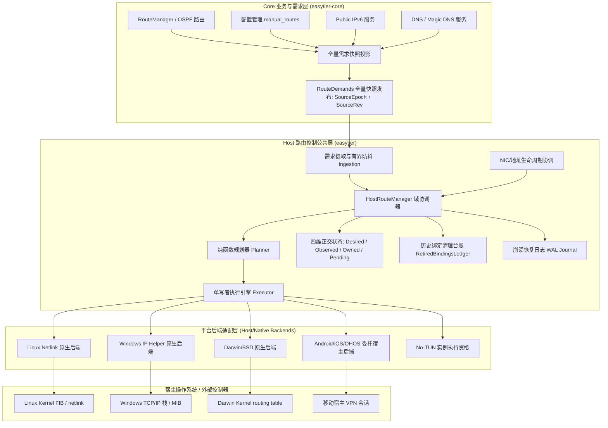
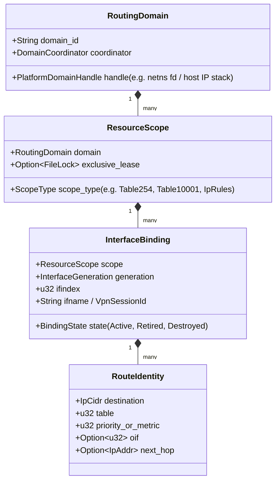
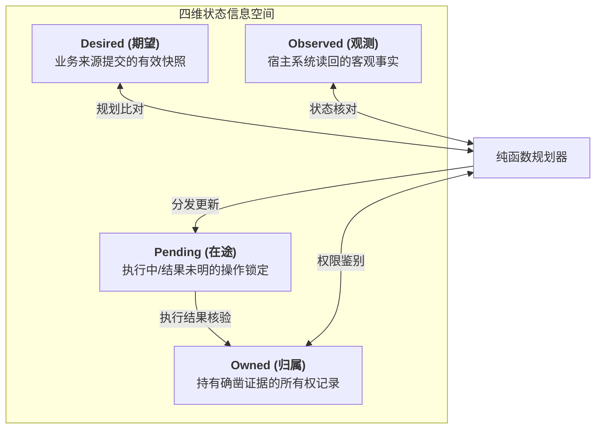
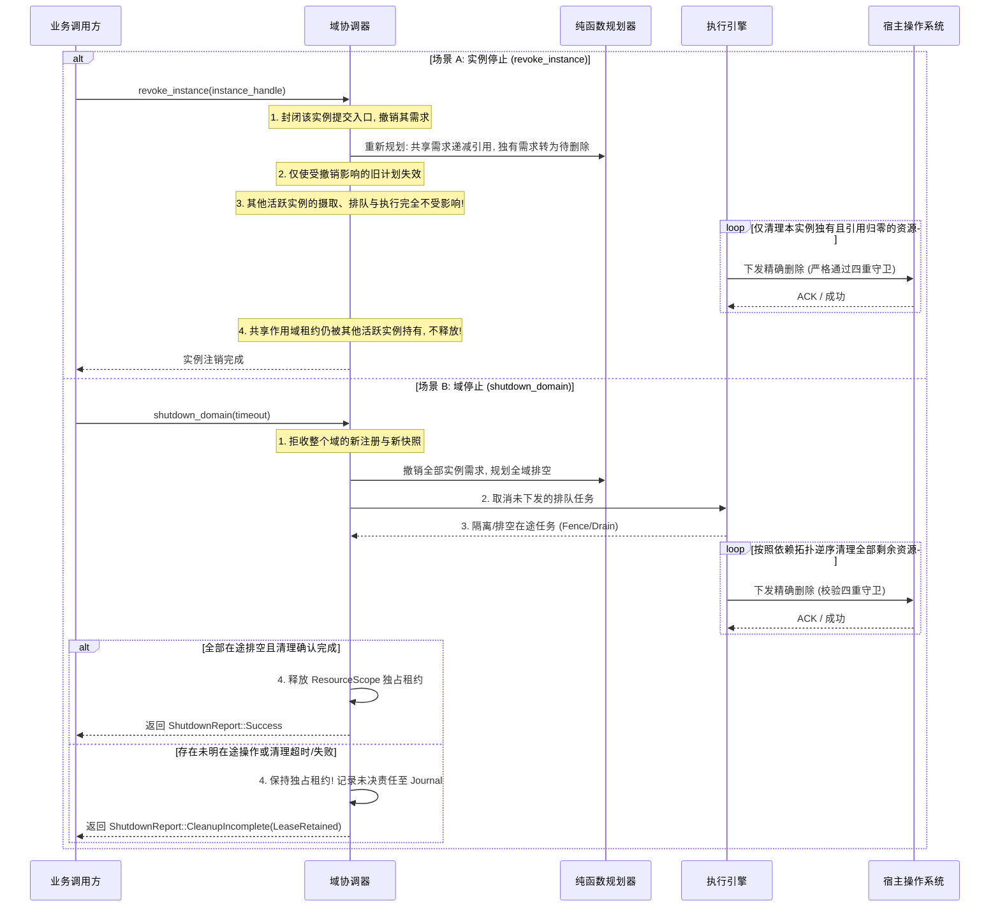

# HostRouteManager 第一步：行为契约、路由审计与平台能力矩阵（第四轮修订版）

状态：已根据第四轮审查意见（[`docs/host-route-manager-step1-review-4.md`](host-route-manager-step1-review-4.md)）完成深度修订与闭环。明确区分了实例停止与域停止的边界，消除了磁盘不可写时的无日志删除例外，补齐了基于来源 Epoch 与撤销的 Superseded/Revoked 终止条件，并校准了平台构建验证表述。  
依据：《[HostRouteManager 实施总纲](host-route-manager-master-plan.md)》第一步要求。  
基线代码：本地 `main` 分支 `a017dc13`；涉及 DNS 需求部分核对 `feat/dns-policy` (`2569f35f`)；移动端核对 `tauri-plugin-vpnservice`、`easytier-gui` 及 `easytier-ohrs`。所有文件链接使用相对路径，注明分支与源码位置。

---

## 1. 概述与分层定位

本文档是 HostRouteManager 第一步的核心规范。本次修订聚焦于消除可导致错误底层操作的规则漏洞，统一所有执行与恢复分支的证据门槛，并为第二步（版本化路由需求接口）建立完备、自洽的语义基石。

### 1.1 架构分层定位 (Core vs Host/Native)

系统严格按照 **Core（业务与需求抽象，位于 `easytier-core`）** 与 **Host/Native（宿主控制与平台适配，位于 `easytier`）** 分层。杜绝从历史分支（如 `refactor/route-dev`）倒推引入全局静态单例、容器 downcast 或将 NIC 内部侵入路由控制的旧设计。

---

## 2. 路由来源、系统写入者与事件消费者全景审计

### 2.1 路由分类全景审计清单

对全仓代码进行静态审计，明确每种路由「谁需要、谁写、谁拥有、如何撤销、失败如何报告」：

| 路由类别 | 需求来源 (Who Needs) | 当前直接写入点 (Who Writes) | 当前归属 (Who Owns) | 如何撤销 (How Revoked) | 失败如何报告 (Failure Reporting) |
| :--- | :--- | :--- | :--- | :--- | :--- |
| **自动子网代理路由** `Peer Proxy CIDR` | 对端 Peer 广播自身代理的网段 (`proxy_cidrs`)，宿主需将流量导向 TUN 设备 | **桌面：** `ProxyCidrMonitor` (1s 轮询) -> `VirtualNic::run_proxy_cidrs_route_updater` -> `IfConfiger::add_ipv4_route` **移动：** `mobile_vpn.ts` 轮询 RPC -> `TauriVpnService.kt` `builder.addRoute` | **无**（直接注入 OS 共享主表或 VPN Session，无归属凭据） | **桌面：** 内存快照做 diff 后调 `remove_ipv4_route`；进程崩溃时泄漏 **移动：** 全量重启 VPN Session | **桌面：** 仅 `tracing::trace!` 记录 **移动：** 前端 catch 后 `console.error` |
| **手工静态路由** `manual_routes` | 用户在配置中显式指定的 CIDR 网段（仅作用于 proxy CIDR 需求集） | **桌面：** 同上（在 `ProxyCidrMonitor::resolve_proxy_cidrs` 中覆盖 peer 路由） **移动：** `mobile_vpn.ts` 前端并集拼装后传给 VPN | **无** | 同自动子网代理路由 | 同自动子网代理路由 |
| **接口直连网段路由** `Link Subnet Route` | TUN 网卡分配 IP 与子网掩码（如 `10.144.144.1/24`）时，由内核网络栈派生的链路前缀 | **Linux/Windows：** `VirtualNic::assign_ipv4_to_tun_device` 添加 IP 时由内核栈自动生成 **移动端：** `builder.addAddress` | **内核/系统栈派生** | 随 IP 移除或网卡销毁由内核自动收回 | 添加 IP 失败抛出错误；内核派生过程无显式报告 |
| **平台显式接口前缀路由** `Explicit Prefix Route` | **macOS / FreeBSD** 平台特性：内核不自动为 TUN 派生子网路由，必须显式安装 | **macOS/FreeBSD：** [`VirtualNic::assign_ipv4_to_tun_device`](../easytier/src/instance/virtual_nic.rs#L839-L846) 显式调用 `nic.add_route`；[`assign_ipv6_to_tun_device`](../easytier/src/instance/virtual_nic.rs#L856-L863) 显式调用 `nic.add_ipv6_route` | **无**（目前由 NIC 代码显式写入系统路由表） | 仅在网卡被关闭或 IP 移除时清理；若崩溃则残留 | 失败向上返回 `Result<(), Error>`，阻断网卡就绪流程 |
| **Public IPv6 默认路由** `::/0` | 开启 public-ipv6 时，分配到的公网 IPv6 前缀出口，用于导入公网流量 | [`VirtualNic::run_public_ipv6_addr_updater`](../easytier/src/instance/virtual_nic.rs#L1181-L1186) -> `nic.add_ipv6_route_with_cost(::, 0, Some(5))` | **无** | 监听到地址变化时调 `nic.remove_ipv6_route(::, 0)`；崩溃则泄漏 | 仅 `tracing::warn!` 记录日志 |
| **Public IPv6 对等节点路由** `Public IPv6 Routes` | 组网内其他节点声明的 Public IPv6 路由条目 | [`VirtualNic::run_public_ipv6_route_updater`](../easytier/src/instance/virtual_nic.rs#L1150) -> `ifcfg.add_ipv6_route` | **无** | 接收事件 diff 后调 `remove_ipv6_route` | 仅 `tracing::trace!` 记录日志 |
| **Magic DNS 虚拟 IP 路由** `fake_ip/32` | Magic DNS 分配的虚拟 IP（如 `7.7.7.7`）不在 TUN 子网内时需导入 TUN | **主线桌面：** [`MagicDnsServerInstance::new`](../easytier/src/instance/dns_server/server_instance.rs#L385-L388) 临时实例化 `IfConfiger{}` 写入 **移动：** `mobile_vpn.ts` 在启用时追加 `100.100.100.101/32` | **无** | **主线桌面：** `MagicDnsServerInstance::clean_env` 主动调用删除（Drop 中不执行，非正常退出泄漏） | 启动失败返回 `anyhow::Result` |
| **macOS 历史残留清理** `10.0.0.0/24` | `rust-tun` 库在 macOS/FreeBSD 创建网卡时默认注入的死路由 | [`VirtualNic::run`](../easytier/src/instance/virtual_nic.rs#L1256-L1260) -> `nic.ifcfg.remove_ipv4_route("10.0.0.0", 24)` | **无** | 仅开机单次显式删除 | 忽略错误 `let _ = ...` |

> [!NOTE]
> **关于 `feat/dns-policy` 分支的审计核实：** 经对分支 `2569f35f` 源码的深入核对，其 `ProxyCidrsMonitor::diff_proxy_cidrs` 顶层代码仅合并了 manual routes、peer proxy CIDRs 以及 VPN portal client CIDRs，不存在活跃读取 `dns.addresses()` 注入 `proxy_cidrs` 的行为；早期历史 commit `86871b14` 中的试验代码未在当前分支生效。DNS 路由在主线仍以 `MagicDnsServerInstance` 的独立写入点为准。

### 2.2 现有系统写入点代码审计

1. **`easytier/src/instance/virtual_nic.rs`**：
   - 内部包含 3 个由 `tasks: JoinSet` 托管的长期 updater 任务：
     - `run_proxy_cidrs_route_updater`（[Line 1048](../easytier/src/instance/virtual_nic.rs#L1048)）：监听 `GlobalCtxEvent::ProxyCidrsUpdated`。
     - `run_public_ipv6_route_updater`（[Line 1118](../easytier/src/instance/virtual_nic.rs#L1118)）：监听 `GlobalCtxEvent::PublicIpv6RoutesUpdated`。
     - `run_public_ipv6_addr_updater`（[Line 1171](../easytier/src/instance/virtual_nic.rs#L1171)）：监听 `GlobalCtxEvent::PublicIpv6Changed`。
   - 以及 2 个辅助路由应用函数：`apply_route_changes` 和 `apply_public_ipv6_route_changes`。
   - **关键缺陷分析**：
     - **错误推进缓存**：以 `apply_route_changes` 为例（[Line 997](../easytier/src/instance/virtual_nic.rs#L997)），无论底层 `ifcfg.add_ipv4_route` 返回成功还是打 trace 日志，均执行 `cur_proxy_cidrs.insert(cidr)`。导致失败后本地缓存假定其已存在，永久失去重试机会。
     - **缺乏系统核对**：完全依赖内存 `cur_proxy_cidrs`。若系统路由被外部工具篡改或删除，代码无法自愈。
     - **缺少优雅停机与清理协议**：`VirtualNic` 仅在销毁时被动丢弃 `JoinSet`，没有在退出时执行显式的已安装路由清理流程，缺乏收敛和清理保障。
   - **资源泄漏的真实边界**：临时 TUN 设备在被关闭时，内核通常会自动清理与其绑定的链路直连路由和出接口路由；但持久网卡、命名空间残留对象、外部持久会话或将来加入的策略路由规则（IP rules），会发生系统级持久泄漏。

2. **`easytier/src/instance/dns_server/server_instance.rs`**：
   - `MagicDnsServerInstance::new`（[Line 385–388](../easytier/src/instance/dns_server/server_instance.rs#L385-L388)）在 `fake_ip` 不属于 `tun_inet` 时直接实例化 `IfConfiger {}` 写入 `/32` 路由。
   - **NetNS 作用域隐患**：该调用未持有 `NetNSGuard`。在实例运行于独立 netns 且当前线程未处于该 netns 的场景下，会导致系统调用在错误的命名空间执行。
   - **清理隐患**：清理代码仅在显式调用 `clean_env`（[Line 444](../easytier/src/instance/dns_server/server_instance.rs#L444)）时执行，`Drop` 中未调用，异常退出必漏。

3. **`easytier/src/instance/virtual_nic.rs:839 & 856` (macOS / FreeBSD 显式前缀路由)**：
   - 在 macOS 和 FreeBSD 平台上，调用 `assign_ipv4_to_tun_device` 和 `assign_ipv6_to_tun_device` 分别显式调用了 `nic.add_route` 和 `nic.add_ipv6_route`。
   - **迁移阻断隐患**：若将接口前缀路由错误地视作“内核派生直连”而不纳入 HostRouteManager 显式需求，在解耦 NIC 与路由管理后，macOS/FreeBSD 将丢失虚拟子网基础连通性。

### 2.3 独立的事件消费者全景清单

路由变更事件不仅供底层网络栈使用，还被全仓多个组件消费：

1. **`CoreEventSink` (`easytier-core/src/events.rs`)**：
   - 事件：`CoreEvent::ProxyCidrsUpdated`、`CoreEvent::PublicIpv6RoutesChanged`、`CoreEvent::PublicIpv6Changed`。
   - 消费者：Core 内置事件发布通道，桥接至各外部宿主。
2. **`GlobalCtxEvent` 广播总线 (`easytier/src/common/global_ctx.rs`)**：
   - 事件：`GlobalCtxEvent::ProxyCidrsUpdated`、`GlobalCtxEvent::PublicIpv6RoutesUpdated`、`GlobalCtxEvent::PublicIpv6Changed`。
   - 消费者：
     - `VirtualNic` 中的 3 个 updater 任务。
     - CLI 事件日志器 [`easytier/src/instance/cli_event_logger.rs:216`](../easytier/src/instance/cli_event_logger.rs#L216)：格式化打印日志。
     - Tauri 运行时 [`easytier-gui/src-tauri/src/lib.rs:1116`](../easytier-gui/src-tauri/src/lib.rs#L1116)：序列化并转发给前端。
3. **Android 活跃控制链与 GUI 监听器 (`easytier-gui/src/composables/event.ts`)**：
   - **关键控制链**：[`event.ts:88–94`](../easytier-gui/src/composables/event.ts#L88-L94) 在收到 `EVENTS.PROXY_CIDRS_UPDATED` 时，以及在 [`event.ts:96–100`](../easytier-gui/src/composables/event.ts#L96-L100) 收到 `EVENTS.EVENT_LAGGED` 时，**均主动调用 `onNetworkInstanceUpdate(instanceId)`**，直接触发 Android VPN 配置核对与隧道重建（`prepareVpnService`）。这不仅是 UI 通知，更是一条核心的移动端控制链路！
4. **WASI 适配器 (`easytier-core/src/wasi/adapter/event.rs:52`)**：
   - 将 `CoreEvent::ProxyCidrsUpdated` 序列化为 `"proxy_cidrs_updated"` 供 WebAssembly 宿主查询。
5. **Public IPv6 Provider 观察链 (`easytier/src/instance/public_ipv6_provider/linux.rs`)**：
   - [Line 338](../easytier/src/instance/public_ipv6_provider/linux.rs#L338)：调用 `list_ipv6_route_messages` 扫描系统默认路由以发现 WAN 上行接口。
   - **NDP 代理路由采集**（[Line 523](../easytier/src/instance/public_ipv6_provider/linux.rs#L523)）：通过 `collect_public_ipv6_tun_routes` 观察 TUN 设备上的 public IPv6 路由，以驱动 Linux NDP 代理响应。

---

## 3. 配置项精确作用域与桌面/移动端行为决策

### 3.1 `manual_routes` 作用域的精确界定 (Addressing R1/S1)

针对审查意见，在此严格界定 `manual_routes`（配置键 `services.manual_routes` / CLI `--manual-routes` / 配置项 `routes`）的生效边界：

1. **唯一作用域**：`manual_routes` **仅且仅覆盖「对端子网代理路由 (Peer Proxy CIDR)」这一单一来源**。
2. **独立性保证**：
   - **不影响本机代理发布**：本机是否向网络通告子网代理（配置项 `proxy_cidrs`），由 PeerManager 广播逻辑决定。
   - **不影响报文转发**：内核与 TUN 的报文转发能力不受其影响。
   - **不影响其他路由来源**：接口直连/前缀路由、Magic DNS `/32` 路由、Public IPv6 默认路由 (`::/0`) 及 Public IPv6 peer 路由各自拥有独立的生命周期和计算规则，**绝对不受 `manual_routes` 的影响**。
3. **配置取值语义严格冻结**：
   - `manual_routes = None`：**自动跟随模式**。Proxy CIDR 需求集动态跟随并投影所有合法的对端 proxy CIDRs。
   - `manual_routes = Some([])`（显式空集合）：**代理路由禁用模式**。用户明确要求**“不自动安装来自对端的代理路由”**。Proxy CIDR 需求集结果为**空集合**，彻底抑制对端代理路由；但其他独立来源（DNS、IPv6、接口路由）照常工作，且通过这些独立路由仍可访问特定目标。
   - `manual_routes = Some([A, B])`：**静态覆盖模式**。Proxy CIDR 需求集结果严格为 `[A, B]`，所有对端代理路由被覆盖抑制。

### 3.2 验收反例：多来源共存矩阵

当系统中同时启用自动代理、手工路由、Magic DNS、接口前缀和 Public IPv6 时，不同 `manual_routes` 配置下的期望路由输出如下表所示：

| 配置场景 | Proxy CIDR 需求集 | 接口前缀需求集 (IPv4/IPv6) | Magic DNS `/32` 需求集 | Public IPv6 出口需求集 (`::/0`) | 最终期望路由合计 (Desired Snapshot) |
| :--- | :--- | :--- | :--- | :--- | :--- |
| **场景 A** `manual_routes = None` | 对端上报的 `10.0.0.0/8` 和 `172.16.0.0/16` | `10.144.144.0/24` `fd00::/64` (macOS/BSD需显式安装) | `7.7.7.7/32` (不在TUN网段内) | `::/0` (metric=5) | **全部安装**：2条对端代理 + 2条接口前缀 + 1条DNS + 1条公网IPv6出口 |
| **场景 B** `manual_routes = Some([])` (显式空集合) | **空集合 `[]`** (不自动安装对端代理) | `10.144.144.0/24` `fd00::/64` | `7.7.7.7/32` | `::/0` (metric=5) | **仅抑制代理路由，其余保留**：0条代理 + 2条接口前缀 + 1条DNS + 1条公网IPv6出口 |
| **场景 C** `manual_routes = Some([192.168.1.0/24])` | 仅 `192.168.1.0/24` (对端代理被完全覆盖) | `10.144.144.0/24` `fd00::/64` | `7.7.7.7/32` | `::/0` (metric=5) | **覆盖代理路由，其余保留**：1条手工代理 + 2条接口前缀 + 1条DNS + 1条公网IPv6出口 |

### 3.3 桌面端与移动端行为差异及纠偏决策

| 维度 | 桌面端 (Desktop / CLI) | 移动端 (Android / Tauri / GUI) | 鸿蒙端 (OpenHarmony `ohrs`) | 纠偏决策与迁移规划 |
| :--- | :--- | :--- | :--- | :--- |
| **路由决策归属** | `easytier-core` 的 `cidr_monitor.rs` | `easytier-gui/src/composables/mobile_vpn.ts` | `easytier-ohos-core/src/routing.rs` | **废除前端/Bridge推导**：所有平台统一由 Core 发布规范化的 `RouteDemandsSnapshot` |
| **`manual_routes` 语义** | 覆盖 (Override) 对端代理路由 | 并集 (Union) 拼接 peer 与 manual | 并集 (Union) 拼接并做子网简化 | **纠偏为覆盖 (Override)**：移动端的 Union 属于实现缺陷，统一采用 Core 覆盖语义 |
| **`manual_routes = Some([])`** | 正确抑制代理路由 | 错误回退为安装所有 peer 路由 | 依然安装 peer 路由 | **纠偏**：统一纠偏为 3.1 节定义的禁用对端代理路由行为 |
| **Magic DNS 路由** | 动态判断是否在网段外并添加 `/32` | 前端强行硬编码 `100.100.100.101/32` | 未接管 | **统一抽象为 Host 需求来源**：由 Magic DNS 注册明确需求，禁止前端写死 |
| **IPv6 配置能力** | 支持 IPv6 直连前缀与公网出口 | 支持 IPv6 底层配置（代码已调用 `builder.addAddress("fd00::1", 128)`），但路由链未贯通 | 具备 CIDR 规范化能力，待完善下游应用 | **明确 Android 具备 IPv6 潜力**，在委托后端契约中放开 IPv6 路由传递 |

---

## 4. 稳定路由域、资源作用域、代际绑定与条目匹配

针对审查意见 T3，彻底厘清需求等价性、内核冲突与选路冲突的边界：

### 4.1 四层概念分离契约

1. **`RoutingDomain` (宿主稳定路由域)**：
   - 代表平台网络协议栈的隔离实体：Linux 下为单一网络命名空间（以 `/proc/self/ns/net` 的 inode 或 netns fd 为标识）；Windows/macOS 下为主机网络协议栈；Android 下为当前 App 运行沙箱。
   - **生命周期**：跨越网卡重建，是长久稳定的协调中枢。一个 RoutingDomain 内部运行一个 `DomainCoordinator`。
2. **`ResourceScope` (资源作用域)**：
   - 代表 RoutingDomain 内可独立寻址或操作的资源集合：如 Linux 的主路由表（table 254）、专用路由表（table 10001）、IP 规则集（RPDB）。
   - **跨进程排他租约**：
     - **严禁对共享主表（table 254）施加跨进程粗粒度排他锁**！多个 EasyTier 进程使用各自独立 TUN、写入主表互不重叠的路由时，必须被允许并行工作。
     - 仅对真正要求独占的资源作用域（例如专用的 Linux table ID，或特定优先级范围的 `ip rule`）通过命名文件锁申请独占租约。
3. **`InterfaceBinding` (带代际的接口/会话绑定)**：
   - 代表一次具体的网卡创建或 VPN 会话生命周期，绑定具体的 `ifindex`、`ifname` 或 `VpnSessionId`。
   - 携带严格单调递增的代际计数器 `InterfaceGeneration`。网卡重建、崩溃重连或 Android 重新获取 fd 时，生成新的代际。
4. **`RouteIdentity` (条目精确身份键)**：
   - 用于在平台底层精确定位一条路由：必须完整包含目标前缀、路由表 ID、优先级/Metric 以及出接口 (`oif`) / 下一跳 (`next_hop`)。

### 4.2 需求等价性、内核操作冲突与多表共存 (Addressing T3)

严格区分三个维度的概念，杜绝冻结未经验证的单一键公式：

1. **需求等价性 (Demand Equivalence) 与共享引用条件**：
   - 两个业务需求能够合并并共享引用的**充要条件**是：**具有完全相同的转发语义与属性**（同一 Domain、同一目标前缀、同一出口网卡、同一下一跳、相同路由表、兼容的 metric）。
   - **快照幂等引用计数**：引用计数必须由**有效来源集合派生**（`HashSet<SourceId>`），重复提交相同快照不得重复增减引用。
2. **内核操作冲突 (Kernel Operation Collision)**：
   - 内核在单次系统调用中判定条目冲突的规则因平台和地址族而异：
     - **Linux IPv4 主表**：采用 `NLM_F_CREATE | NLM_F_EXCL` 下发时，只要 `Table + Prefix + Priority + Tos` 相同，即使 `oif` 不同，内核 `fib_table_insert` 也会返回 `EEXIST` 冲突。因此，不能将 `oif` 误当作防止内核冲突的独立分区键。
     - **Windows IP Helper**：`CreateIpForwardEntry2` 要求 `DestinationPrefix + InterfaceLuid + NextHop` 唯一，相同槽位不能仅因 Metric 不同而创建两条独立条目。
3. **选路冲突 vs 多表安全共存**：
   - **同一流量的选路冲突 (Routing Conflict)**：同域内的两个实例（如实例 A 要送往 `tunA`，实例 B 要送往 `tunB`）若在同一选路规则下争抢相同的目的地址，属于业务冲突，必须由冲突仲裁器报错或退避。
   - **多表安全共存 (Multi-Table Coexistence)**：若两个相同前缀的需求分配在不同的路由表（如 table 10001 与 table 10002），且通过互斥的 IP rules（如根据入接口、源 IP 或 `socket_mark` 匹配）导向不同表，它们在内核中**完全可以安全共存**。不等价绝不等于不可共存！

### 4.3 代际生命周期与历史清理守卫 (Addressing S3/T1)

为彻底解决“历史台账误删新代际相同属性路由”的严重缺陷，确立以下规则：

1. **历史台账性质**：`RetiredBindingsLedger` 仅证明存在尚未交接的**清理责任**，不证明当前观测到的条目仍是旧代际对象。
2. **强绑定资源的生命周期终结**：当原接口被确认已物理销毁时，内核自动剥离的网卡绑定路由，其清理责任**立即安全终结**，从台账注销。
3. **删除授权四重守卫 (Deletion Guard)**：执行删除操作必须同时满足以下条件：
   $$\text{CanDelete}(e) \iff \text{Owned}(e) \land \text{BindingValid}(e) \land \neg\text{IsDesired}(e) \land \neg\text{InFlightConflict}(e)$$
   - **条件 1（归属证据）**：条目具备确凿的 `Owned` 凭据；
   - **条件 2（绑定有效）**：条目属于当前有效绑定，或属于未确认销毁的历史绑定；
   - **条件 3（当前无需求）**：目标条目**不满足当前任何活跃的 Desired 需求**（若新代际也需要完全相同的条目，旧清理责任被新代际认领/合并，严禁物理删除）；
   - **条件 4（在途互斥）**：当前无针对该条目的并发操作。
4. **身份复用无法区分时的处置**：若接口重建后复用了 `ifindex`，且当前系统中的条目无法通过底层标记与新需求区分，系统**进入 `Uncertain` 状态，不执行删除**。非接口绑定资源（如 IP rules）另按 ResourceScope 生命周期独立管理。

---

## 5. 四维状态模型、严格归属准入与操作核验

针对审查意见 T1，统一所有正常与故障分支的归属证据标准，严禁以弱证据认领外部资源。

### 5.1 四维并发正交状态模型

四个状态维度相互独立、同时存在，共同描述受管资源在某一时刻的全貌：

### 5.2 统一归属准入标准与按 Action 严格核验 (Addressing T1)

无论常态执行、操作超时、还是崩溃恢复，必须遵循**完全统一的归属证据标准**：

1. **统一归属准入规则**：
   - 严禁在故障或恢复分支降低证据门槛。
   - **Intent + Binding + Desired 绝不构成成功创建的证据**！若系统崩溃前仅有 `Intent` 而无 `Commit`，重启后读回即使条目存在，**严禁补写 `Owned(CreatedByUs)`**！必须将其标记为 `OutcomeUnknown`，若属性吻合则降级视为 `ExternalSatisfied`，绝不承担本方创建的所有权，退出时绝不执行删除。
2. **按 Action 定义核对结果**：
   - **Add 操作**：
     - 前态：确认系统中不存在。
     - 目标后态：存在且属性完全匹配。
     - **超时核对**：若 Add 操作超时后读回发现条目存在，但无法排除外部并发创建（如返回过 `EEXIST` 或响应丢失），严禁补记 `Owned`！必须降级标记为 `OutcomeUnknown` 或 `ExternalSatisfied`。
   - **Delete 操作**：
     - 前态：存在。
     - 目标后态：不存在。
     - **超时核对**：若 Delete 操作超时后读回发现条目依然存在，**绝不能武断判定为“删除失败并再次删除”**！读回存在仅证明当前存在，不能证明当前条目的身份与原条目连续（可能原删除已完成，第三方随后建立了同属性条目；也可能原请求仍在底层积压）。必须先核实旧执行者状态与归属连续性；若无法确证，保持 `Uncertain` / `DeletePending`，严禁盲目发起二次删除。
   - **Replace 操作 (PlannedMismatch 严格前置核验)**：
     - 前态必须验证：系统当前条目必须严格匹配本方最后确认的前态属性 $A$。
     - 目标后态：新属性 $B$。
     - **并发外部篡改拦截**：若在准备 Replace 时，系统当前条目变成了第三种属性 $C$ ($C \neq A$ 且 $C \neq B$)，说明发生了外部并发修改，**严禁盲目执行 Replace**！必须立刻终止替换，转入 `Conflicted` 状态并报警。
3. **共享表协作假设与保证边界**：
   - 在缺乏原子条件操作（CAS）和独占锁的共享表上，即使单次外部并发修改落在读回与写入之间，也可能破坏一致性。系统明确陈述协作假设：假定外部工具不会恶意并发介入；一旦检测到外部竞争（如 Replace 前置核验失败），主动退避并报告冲突，绝不通过高频重试强行争抢。

---

## 6. Write-Ahead 恢复日志与持久化失败停机契约

针对审查意见 T2 与 U2，恢复严格的 WAL 顺序契约，并消除无日志删除导致的记录过期漏洞：

### 6.1 严格的 WAL (Write-Ahead Logging) 写入顺序契约 (Addressing T2)

任何在宿主操作系统中产生、需要承担恢复或清理责任的系统修改（包括 `Add`、`Delete`、`Replace`），必须严格遵循以下三阶段顺序：

1. **预写意图 (Log Intent & Flush)**：
   - 执行引擎必须先将操作意图落盘并完成持久化刷新：
     $$\text{Write Journal: Intent}(\text{OpId}, \text{Action}, \text{RouteIdentity}, \text{ExpectedPreState}, \text{TargetPostState}, \text{Gen}) \to \text{fsync / flush}$$
   - **前置屏障**：在 `Intent` 确认落盘前，**严禁向底层网络栈下发任何系统调用**！
2. **底层执行 (Execute Platform Action)**：
   - 调用底层原生 API（Netlink / IP Helper / Shell CLI）执行操作。
3. **记录确认 (Log Commit & Flush)**：
   - 收到平台确认成功或读回验证吻合后，写入完成标记并落盘：
     $$\text{Write Journal: Committed}(\text{OpId}, \text{ResultProof}) \to \text{fsync / flush}$$

### 6.2 持久化失败与停机契约 (Disk Failure Boundary, Addressing U2)

1. **常规修改全面停机**：
   - 当日志持久化发生 I/O 错误（如磁盘满、只读文件系统、权限错误）时，**所有常规的路由与规则修改（包括 `Add`、`Delete`、`Replace`）必须立即中止**！
   - 严禁将 `Add` 误当作“非破坏性操作”而在无日志保护下继续执行。
2. **在途操作降级核对**：
   - 既有在途操作的副作用被标记为 `Degraded(JournalIoError)`，系统进入只读降级状态，保留现场供人工排查，防止产生无法被追踪和恢复的脏路由。
3. **消除无日志删除例外 (Addressing U2)**：
   - **严禁在日志不可写时仅凭内存凭据向系统下发无日志的 `Delete`**！
   - *原因分析*：若在磁盘只读时删除了路由 $R$，但未能在磁盘写入 `Delete Intent`，则磁盘上残留着旧的 `Committed(R)`。进程退出后外部若在相同接口重新创建同属性路由 $R$，下次启动恢复端会因磁盘记录的旧 `Committed` 错误认领外部新建的 $R$。
   - **安全处置契约**：日志不可写时，退出流程**不发起新的底层路由删除修改**。系统如实向调用方返回 `CleanupIncomplete(JournalUnavailable)`，保留磁盘未完成责任。网卡底层设备被 OS 自身回收属于接口生命周期事件，绝不伪装为已成功持久化的路由清理。

---

## 7. 完整停止屏障、实例/域解耦与跨进程接管契约

针对审查意见 T4 与 U1，明确区分实例停止与域停止边界，闭合租约释放与跨进程接管：

### 7.1 实例停止 vs 域停止的生命周期解耦 (Addressing U1)

在一个 `RoutingDomain` 内运行单个或多个实例时，必须严格区分两类对外操作：

1. **实例停止 (`revoke_instance(instance_handle)`)**：
   - **边界**：仅在协调器内部封闭该实例的注册与提交入口，撤销该实例注入的所有需求来源。
   - **计划重算**：规划器重新计算：共享需求引用计数递减；只有引用归零的独有资源才转化为待删除目标。
   - **执行隔离**：**同域内其他实例的快照摄取、重试、排队与执行继续全速运行，绝不中断或取消全域队列**。
   - **租约保护**：只要该作用域内还有其他实例在运行，**绝对不得释放 ResourceScope 的独占租约**。
2. **域停止 (`shutdown_domain(domain_handle, timeout)`)**：
   - **触发时机**：整个域服务下线（如进程退出，或最后一个实例退出且域生命周期终结）。
   - **步骤**：
     1. 拒收整个域的新注册与新快照；
     2. 撤销全部剩余实例需求；
     3. 停止排队并排空在途任务（Drain/Fence）；
     4. 按依赖拓扑逆序安全清理所有 Owned 资源；
     5. 判定租约释放：若有未决在途操作或清理超时失败，返回 `CleanupIncomplete(LeaseRetained)` 并**保持租约**；仅当全量排空且清理确认完成时才安全释放租约。

### 7.2 崩溃后的跨进程接管契约 (Crash Recovery & Handoff, Addressing T4)

当进程崩溃退出、文件锁被操作系统被动释放时，新进程接管必须遵循以下协议：

1. **WAL 日志核对先行**：
   - 新进程获取租约后，必须首先读取恢复日志，扫描是否存在前任留下的 `InDoubt` 在途记录，并按 5.2 节的归属准入规则进行清算。
2. **委托宿主会话代际失效 (Session Generation Invalidation)**：
   - 针对 Android VpnService 或 iOS 委托宿主：新进程启动时必须生成单调递增的 `SessionEpoch`，并向宿主系统服务发起会话重置指令。
   - 宿主服务强制使所有旧会话的回调和配置失效，彻底阻断崩溃前残留的异步 VPN 请求在新进程运行期间回踩系统状态。

---

## 8. 快照即事实的单向版本化流转契约

针对审查意见 T5、T6、S8 与 U3，恢复全量快照作为唯一事实源，明确等待令牌与生命周期替代条件：

### 8.1 完整快照事实源与无遗漏订阅 (Addressing T5)

为保证第二步（建立版本化路由需求接口）顺利实施，冻结以下接口语义：

1. **快照是事实，通知是提示 (Snapshots as Truth, Notifications as Hints)**：
   - **恢复总纲核心契约**：每个需求来源每次提交必须是其持有的**全量需求快照**，附带单调递增的 `(SourceEpoch, SourceRevision)`。
   - 通知仅用于唤醒协调器（Event-driven trigger），不承载唯一增量数据。
   - **丢通知与乱序自愈**：若通知队列溢出（Lagged）、丢失或乱序，协调器无需任何增量补丁逻辑，只需直接向来源拉取最新的全量快照，即可瞬间恢复一致性。低版本快照（`rev < current_rev`）直接被幂等丢弃。
2. **原子无遗漏订阅窗口**：
   - 订阅接口必须保证“原子订阅建立 + 获取当前全量快照”，使接收方在建立订阅的瞬间取得基线事实，后续变更通知无缝衔接。
3. **来源身份与生命周期**：
   - `SourceId = (SourceType, Uuid)` 全局唯一。
   - 重新注册分配递增的 `SourceEpoch`。
   - 撤销时记录 `Tombstone(SourceId, Epoch, FinalRev)`，防范旧消息复活。
   - 区分 `SourceUnavailable`（临时不可达，需求保持 stale 状态不删除）与 `Revoked`（显式注销，需求退出）。

### 8.2 对外等待令牌与精确完成语义 (Addressing T6, U3)

统一异步状态查询接口 `wait_convergence(token: SourceSubmissionToken, timeout: Duration)`：

1. **类型化提交令牌**：
   - 第二步直接绑定核心的 `SourceSubmissionToken { source_id: SourceId, epoch: u64, revision: u64 }`。
2. **互斥且确定的完成状态定义与生命周期替代契约 (Addressing U3)**：
   - **`Accepted`**：需求已被协调器接收并排队，计划待执行。
   - **`HostConfirmed`**：委托宿主（如 Android VpnService）已确认配置生效。
   - **`Verified`**：原生后端已调用系统接口并完成读回验证，真实 FIB 中已确认条目。
   - **`Superseded` (生命周期完整定义)**：所等待的特定提交由于以下任一原因被替代作废：
     1. 该来源以**更高的 Epoch** 重新注册提交（`new_epoch > epoch`）；或
     2. 该来源在**同一 Epoch 内提交了更高的 Revision**（`new_epoch == epoch && new_rev > revision`）。
   - **`Revoked`**：在等待期间，该来源被显式撤销注销，等待立即终止并返回此结果，绝不悬挂至超时。
   - **`Conflicted`**：发生外部争抢或业务冲突，**独立返回此状态，绝不混淆为 Superseded**。
   - **`Degraded`**：部分操作失败、日志异常或处于只读降级状态。
   - **`Unsupported / Skipped`**：如在 No-TUN 模式下，需求被显式跳过。
   - **`CleanupIncomplete`**：退出清理未能在时限内彻底完成。
3. **隔离性原则**：无关来源的更新绝不影响当前 Token 的等待判定；旧 Epoch 产生的结果不能满足新 Epoch 的等待。

### 8.3 有界延迟防抖与调度公平性 (Addressing S8)

为防止高频更新（如每 20ms 一次）导致防抖定时器无限顺延、甚至饿死稳定来源：

1. **最大等待预算 (Max Processing Horizon)**：
   - 协调器引入有界防抖：设定防抖延迟（如 50ms）的同时，设定**硬性最大等待上限（Max Horizon，如 200ms）**。
   - 无论后续快照是否仍在涌入，一旦到达最大上限，协调器必须锁定当前最新快照启动纯函数规划。
2. **多来源调度公平性**：
   - 划分来源通道：高频抖动的对端路由不能阻塞已就绪的 DNS 或接口前缀路由。
   - 重试、观测自愈与退出屏障享有独立调度预算，不得被高频业务快照饿死。
   - 退出请求（Shutdown）立即打断防抖窗口，强制进入停止屏障。

---

## 9. 选路策略边界与 Provider 反馈防御

针对审查意见 S6，消除 LAN 优先、冲突状态与外层绕行之间的表述矛盾：

### 9.1 策略允许优先 vs 意外抢占冲突 (Addressing S6)

必须严格区分三类运行状态，消除规划器自相矛盾：

1. **`Installed` (本方路由已就绪)**：本方期望的路由已在内核正确安装。
2. **`PolicyPermittedPrecedence` (策略允许的外部优先)**：
   - 例如经配置认可的本地局域网物理直连路由（LAN Bypass），其优先级高于 EasyTier 路由是**符合设计预期的正常策略**，**绝不能被规划器误报为 `TrafficHijackedConflict`**。
3. **`TrafficHijackedConflict` (意外抢占冲突)**：
   - 只有在未经授权的外部路由以更高优先级覆盖了 EasyTier 期望管理的专属网段时，才判定为劫持冲突。

### 9.2 外层传输防环的可验证包路径要求

- **包路径不变量**：EasyTier 传输层报文（物理 UDP/TCP 连接、STUN 探测、P2P 穿透报文）必须直达物理上行网卡，**绝对不得路由进入 EasyTier 自身的 TUN 网卡**。
- **机制适配而非绝对定理**：
  - 承认 `socket_mark` 的局限性（如 [`easytier/src/socket/fake_tcp/mod.rs:440`](../easytier/src/socket/fake_tcp/mod.rs#L440) 中 FakeTCP 仅对 decoy socket 生效）。
  - 外层绕行根据平台传输能力灵活适配（Linux 下结合 `SO_BINDTODEVICE` 物理网卡绑定、源地址绑定与 socket mark），不把单一标记宣称为绝对防环手段。

### 9.3 Public IPv6 Provider 反馈回路防御契约

为防止 [`public_ipv6_provider/linux.rs:338`](../easytier/src/instance/public_ipv6_provider/linux.rs#L338) 将 EasyTier 自身的 `::/0` 路由当成上游物理出口：

1. **接口分类与排除**：Provider 模块在调用 `list_ipv6_route_messages` 扫描 WAN 接口时，必须依据**接口身份（排除所有已知 EasyTier TUN 接口）**，不得依赖不可靠的 magic protocol。
2. **保留 NDP 同步需求**：保留 [`linux.rs:523`](../easytier/src/instance/public_ipv6_provider/linux.rs#L523) 中的 `collect_public_ipv6_tun_routes`，用于获取 EasyTier TUN 设备上的 public IPv6 路由以同步 NDP 代理。

---

## 10. 真实的四维平台能力矩阵与证据边界

针对审查意见 T7 与第四轮修正，根据代码现状、真实 CI/测试环境与系统潜力，客观重构矩阵（当前 CI 中 Windows 与 macOS 仅执行构建验证，真实系统网络调用待第四步验证）：

| 平台分类 | 系统底层 API 潜力 | 当前代码库已实现 | 本次实施目标 (HostRouteManager) | 验证状态与证据边界说明 (Addressing T7) |
| :--- | :--- | :--- | :--- | :--- |
| **Linux** | **原生完全**：Netlink dump/replace/event, 多表, FIB rule, netns | **原生可用**：`NetlinkIfConfiger` 支持基本增删与 dump；但 NetNSGuard 存在多线程跨 await 调度隐患 | **原生高强度**：Netlink Socket 显式绑定 netns；实现精确 Replace、异步组播读回验证、专用表策略 | **部分验证**：主线 CI（Ubuntu）运行了基本网络测试；但 netns 显式绑定与多表策略待第四步专门验证 |
| **Windows** | **原生完全**：IP Helper NetIO (`GetIpForwardTable2`, `DeleteIpForwardEntry2`, `NotifyRouteChange2`) | **原生部分**：`WindowsIfConfiger` 使用 LUID 增删；缺乏精确读回与异步变更订阅 | **原生高强度**：完善 `MIB_IPFORWARD_ROW2` 规范化（Metric 为 offset，必须提供 DestinationPrefix、NextHop 与 LUID/Index），利用 NotifyRouteChange2 监听变化，实现基于 Win32 API + 读回的高确认强度 | **静态核对完成，行为待验证**：当前 CI（Windows runner）仅执行构建验证，未在真实 Windows 环境下执行路由调用测试，第四步须补齐平台测试 |
| **macOS** | **原生中等**：BSD Route Socket (`PF_ROUTE`) 支持结构化监听与 sysctl dump | **Shell CLI 包装**：`MacIfConfiger` 通过 `sh -c route -n` 执行命令，按进程退出状态码判定成功 | **架构目标明确**：在公共层确立纯函数规划与读回核对；首期交付带读回核对的 CLI 适配器，明确其无法原子 Replace 的局限，为结构化 route socket 预留明确接口 | **静态核对完成，行为待验证**：当前 CI 仅执行构建验证，未执行真实网络测试，第四步须在真实 macOS 环境验证 |
| **FreeBSD** | **原生中等**：BSD Route Socket, setfib 多 FIB 支持 | **Shell CLI 包装**：同 macOS，使用 `route` 命令 | **架构目标同 macOS**；为多 FIB 策略预留扩展能力 | **静态核对完成，行为待验证**：待第四步真实环境专项回归 |
| **Android** | **委托支持**：`VpnService.Builder` 支持 IPv4/IPv6 地址与路由完整批次声明 | **委托部分**：`TauriVpnService.kt` 具备 `builder.addRoute`，支持 IPv6 地址，但前端仅下发 IPv4 | **委托闭环**：实现 `DelegatedHostRouteBackend`，支持全量快照声明式下发、IPv4/IPv6 对等支持、以会话代际确认 (`HostConfirmed`) 代替底层读回 | **部分验证**：Android IPv4 隧道建立已有实际运行；IPv6 路由下发与快速重建会话待第四步专项验证 |
| **iOS** | **系统支持**：`NEPacketTunnelNetworkSettings` | **未实现 (占位 Stub)**：`tauri-plugin-vpnservice/ios/Sources/ExamplePlugin.swift` 仅为返回 `running=false` 的空壳 | **标记为未支持**：本轮不作生产承诺，明确归类为待开发后端 | **未支持 (Unsupported Stub)**；文档内严格如实标注 |
| **OpenHarmony** (`ohrs`) | **系统支持**：`VpnExtensionAbility` 支持声明式路由配置 | **外部聚合**：`easytier-ohos-core/src/routing.rs` 实现了多实例需求聚合，但下游实际生效脱节 | **委托接入**：对接统一的 `RouteDemandsSnapshot` 导出接口，交由鸿蒙宿主执行 | **待第四步验证实际应用闭环** |
| **macOS NE** (`macos-ne`) | **系统支持**：`NEPacketTunnelNetworkSettings` | **未实现** | **委托后端预留**：与 iOS 采用相同的委托模型 | **未支持** |
| **WASI / 嵌入宿主** | **无原生路由能力** | 仅有事件字符串映射 (`event.rs:52`) | **显式跳过**：绑定 `NoTunRouteBackend`，不报虚假成功 | **静态核对完成**：已验证事件序列化代码 |
| **No-TUN** | **不适用** | **逻辑脱节**：`ProxyCidrMonitor` 在 no-tun 下仍然空转并误发事件 | **实施目标**：绑定 `NoTunRouteBackend`，业务层透明，宿主层完全跳过底层操作，不空转轮询 | **目标确立**：重构后彻底消除虚假事件 |

---

## 11. 扩展故障场景与恢复目录 (Failure Scenarios Catalog)

针对审查意见 T1、T2、T4 与 U1、U2，扩充为涵盖 10 类典型异常的严密处置规范：

1. **场景 1：写入底层成功，但在日志确认前崩溃 (Addressing T1/T2)**
   - **自愈机制**：新进程启动初始化时扫描系统路由表。发现条目存在但 Journal 中仅有 `Intent` 无 `Commit`：严格判定为 `InDoubt`，标记为 `OutcomeUnknown` 或 `ExternalSatisfied`（若属性吻合），**绝不补写 `Committed`，绝不认领为 Owned**。
2. **场景 2：底层操作超时但实际在内核中生效 (Addressing T1)**
   - **自愈机制**：严格按 Action 处理。Add 超时读回存在但无唯一创建证明时，标记为 `ExternalSatisfied`，不创建 Owned；Delete 超时读回存在时，判定为未决/不确定，**严禁在无身份连续性证明下盲目重试删除**。
3. **场景 3：外部管理工具强行清除路由**
   - **自愈机制**：系统路由被外部工具清空后，周期性核对（Reconcile）或 Netlink 异步删路由通知捕获该状态。检查 Desired 依然有效，重新生成 `Add` 操作以实现最终收敛。
4. **场景 4：网卡高频抖动与代际错配 (Flapping)**
   - **自愈机制**：执行引擎在底层系统调用前后比对代际。若代际在调用期间被递增，该操作结果被废弃，操作副作用记入 `RetiredBindingsLedger`。
5. **场景 5：外部持续争抢同一路由槽位**
   - **自愈机制**：连续 3 次检测到外部属性篡改或覆盖，协调器进入指数退避（从 1s、2s 退避至 30s），触发 `RouteConflictAlarm`，坚决停止无效争抢。
6. **场景 6：平台枚举接口临时返回错误 (ENOBUFS)**
   - **自愈机制**：保留上一次成功的 Observed 快照并标记为 `Stale`，**严禁将查询失败视为“系统路由全空”**，禁止发起无序全量重写。
7. **场景 7：委托宿主（Android）用户权限弹窗延迟或拒绝**
   - **自愈机制**：委托后端向 Manager 报告 `PendingAuthorization`，在用户授权前挂起路由应用，不伪造成功，也不导致核心网络服务崩溃。
8. **场景 8：日志文件损坏或磁盘只读 (Addressing T2, U2)**
   - **自愈机制**：状态机进入安全只读降级状态 (`Degraded`)，**全面停止常规增删改下发（包括 Add、Delete、Replace）**。退出流程**绝不下发无日志保护的底层删除**，保留未完成责任如实报告 `CleanupIncomplete(JournalUnavailable)`，防止在磁盘残留旧 Commit 凭据引发未来的错误认领。
9. **场景 9：来源快照乱序与重启 (Addressing T5, U3)**
   - **自愈机制**：依靠来源的 `SourceEpoch` 与 `SourceRev` 双单调保护，任何来自旧 `epoch` 或低于当前最大 `revision` 的迟到快照直接丢弃；等待令牌在遇到更高 Epoch 或同一 Epoch 更高 Revision 时确认为 `Superseded`；显式注销时立即确认为 `Revoked`。
10. **场景 10：业务配置极高频变化（事件风暴） (Addressing S8)**
    - **自愈机制**：协调器依靠硬性最大处理上限（Max Horizon，如 200ms）执行有界防抖，定期截断快照并调度规划，彻底规避饥饿。

---

## 12. 修订总结与第二步准入核对

### 12.1 审查意见修复对照

- [x] **U1 (P1)**：明确区分**实例停止 (`revoke_instance`)** 与**域停止 (`shutdown_domain`)**；实例停止仅撤销本实例需求并重算引用计数，不影响同域其他实例的摄取与排队，不释放共享租约；只有域级停止或最后一个使用者退出才执行全域清理与租约释放（第 7.1 节）。
- [x] **U2 (P1)**：彻底删除“日志不可写时凭内存凭据尽力删除”的例外规则；确立持久化失败时**禁止发起任何无日志保护的底层删除**，防止磁盘残留旧 Commit 导致未来重启错误认领外部同属性条目（第 6.2 节）。
- [x] **U3 (P2)**：完善等待令牌的生命周期替代判断：将 `Superseded` 扩展为同一来源**更高 Epoch** 或**同 Epoch 更高 Revision**；明确来源显式注销时立即返回 **`Revoked`**，消除等待悬挂（第 8.2 节）。
- [x] **细节修正**：将 Windows CI 修正为“构建验证”；将 No-TUN 状态核准为“实施目标”；保留此前已闭合的全部架构契约（第 10 节）。

### 12.2 第二步（建立版本化路由需求接口）准入判定

经本轮针对性修订，第一步中关于所有权归属、持久化屏障、停机协议、需求版本化及平台真实证据的全部阻塞问题均已彻底解决，形成了自洽、严密的技术规范，满足正式进入第二步实施的准入标准。
