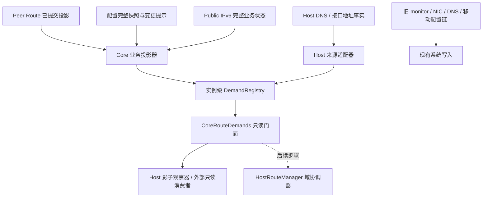

# HostRouteManager 第二步：版本化路由需求接口实施方案

状态：经独立方案对照与源码审查修订，待实施。本文通过不代表实现已完成。

依据：[实施总纲](host-route-manager-master-plan.md)、[第一步行为契约](host-route-manager-step1-audit-and-contract.md)、[第一步验收记录](host-route-manager-step1-review-5.md)。审查工作区基线为 `47bcda9e`；实施前重新确认分支和调用关系。

## 1. 本步交付与边界

交付一个独立于旧 monitor、按来源保存完整事实的需求接口。Core 与 Host 生产者通过同一注册/发布/撤销协议表达需求；消费者随时取得完整状态，无需拼接事件历史。新链路只读接入实例生命周期，旧链路继续承担实际系统写入。

本步完成：

1. 可移植需求模型、实例级来源注册表、只读订阅和提交令牌。
2. 提交后可读的一致业务输入，事件驱动的 Core 投影，Host DNS/接口前缀来源适配。
3. 来源重启、暂不可读、撤销、实例停止和任务异常的内存协议。
4. 影子比对、确定性协议测试、真实生产者接线测试和 feature 构建验证。

本步不实现平台路由身份、跨实例需求合并、选路仲裁、Owned/Pending、持久化日志、系统后端或实际收敛等待；它们属于第三至第五步。GUI/OHOS 生产配置链切换、旧 monitor 删除属于第六至第八步。

“事件驱动”约束新需求投影，不要求此时删除旧链路的 1 秒轮询，也不删除 OSPF 存活检测、租约到期等业务计时器。不得用旧 `ProxyCidrsUpdated` 事件唤醒新投影，否则仍依赖旧 monitor。

## 2. 审查后的取舍

| 原稿设计 | 本方案取舍及原因 |
| --- | --- |
| 全量快照、epoch/revision、tombstone、影子比对 | 保留，补齐权威写入点、异常生命周期和具体测试。 |
| Core 意图携带表号、metric、网卡名；全部解析器放 Core | 删除系统字段；纯模型和注册协议放 Core，Host 事实由 Host 发布，平台策略留 Host。 |
| Core 按 CIDR 聚合并判定 EgressMismatch/TableMismatch | 删除。相同 CIDR 不足以合并，不同表不必然冲突；第二步保留逐来源事实，第三步结合域、绑定与策略决定。 |
| 在 `update_peer_info_last_update()` 广播 | 改为业务事实提交后发布。当前该方法在路由表重建前调用，会唤醒消费者读到旧状态。 |
| ArcSwap、RwLock、broadcast 三处维护发布状态 | 采用短同步锁串行提交，`watch<Arc<RegistrySnapshot>>` 保存并通知完整视图，减少重复状态。 |
| 第二步提供系统级 wait_convergence、移动端直接改用新输出 | 只实现需求登记和生命周期查询，不产生 HostConfirmed/Verified，不切换生产写入。 |
| 随机并发、固定 10ms 延迟、即时新旧一致 | 用可控交错和虚拟时钟验证；比对先对齐输入版本或明确等待稳态。 |

## 3. 架构与职责



- **`easytier_core::route_demand`**：平台无关模型、来源状态机、快照通道、令牌判定和纯投影函数；不依赖 PeerManager、Native NIC 或系统库。
- **`easytier_core::instance::route_demands`**：连接业务输入并管理 Core 投影任务；暴露独立门面，不把新 API 塞进 packet-plane diff。
- **Host 来源适配器**：读取 Host 已持有的 DNS/地址事实，通过受限句柄提交；Core 不反向读取 Host 内部结构。
- **注册表不是域协调器。** 一个 Core 实例运行拥有一个注册表，容纳该实例 Core 与 Host 来源。后续域协调器订阅多个实例；本步不建立跨进程锁或按 CIDR 合并。
- **接口不依赖 `proxy-cidr-monitor`。** No-TUN 也能发布业务需求，执行资格由后续 Host 能力决定，不能将无 TUN 解释为业务需求为空。

## 4. 数据模型

以下固定语义而非提供可直接粘贴的完整代码；类型 derive、错误类型和可见性须经编译验证。

### 4.1 标识与版本

| 类型 | 含义与分配者 |
| --- | --- |
| `InstanceRuntimeId` | 一次实例运行的 UUID，与配置中可复用的 instance UUID 分开。 |
| `RegistryId` | 注册表此次运行的 UUID；跨注册表不比较 view revision。 |
| `SourceId { kind, uuid }` | 来源的全局唯一标识。UUID 是来源 UUID，不是实例 UUID；同实例允许两个 DNS 来源。 |
| `SourceEpoch(u64)` | 注册表为同一 SourceId 的每次重新注册分配，严格递增。 |
| `SourceRevision(u64)` | 当前 epoch 的需求发布版本，由注册表分配，生产者不能自行填数。 |
| `RegistryRevision(u64)` | 每次注册表可见状态改变递增，不冒充来源版本。 |
| `SourceSubmissionToken` | 第一阶段约定的 `(source_id, epoch, revision)`，绑定一次被接受的需求发布。 |

同一运行中重启生产任务保留 SourceId、提升 epoch。整个实例/进程重建时分配新的 RegistryId、InstanceRuntimeId 和 SourceId，旧句柄/消息不能进入新注册表。本步不持久化来源序号，也不允许复用旧 SourceId 后将 epoch 重置。若未来需要持久来源身份，由第五步提供恢复后的单调分配器。

来源业务定位键（kind + 本实例逻辑 slot）由 supervisor 保有，以支持合法重启，不能用 CIDR 充当身份。所有计数使用 checked_add，溢出显式失败，不回绕。

### 4.2 路由需求载荷

`RouteDemand` 至少包含：

- **规范化目标前缀**：支持 IPv4/IPv6，统一网络地址与前缀长度；非法输入报错，不静默忽略。
- **业务用途**：PeerProxy、ManualOverrideProxy、PublicIpv6Default、PublicIpv6Peer、MagicDnsFakeIp、InterfaceSubnet；用途不是内核对象键。
- **逻辑出口**：本实例的 EasyTier packet interface，关联 InstanceRuntimeId。A、B 的 TunDevice 不能被当成同一个出口。不得放入网卡名、ifindex、OS next-hop、table ID、平台 metric。
- **必要依赖**：例如默认出口所依赖的本地 IPv6 租约/地址版本、Host 前缀所依赖的地址事实版本。使用类型化逻辑事实引用，不携带系统句柄。相同前缀的依赖变化也必须可见。

平台兼容策略（旧 Public IPv6 cost=5、Windows DNS cost=4、默认 cost）保留在 Host 迁移映射，后续按用途与后端解析。本步不能凭 metric 数字承诺实际选路优先级。

`SourceSnapshot` 保存完整不可变 demand set、SourceId、epoch/revision 和 `ProjectionBasis`。Basis 记录输入版本供依赖核验、影子诊断；时间戳只作观测，不用于排序、判等或归属。

输出和测试采用确定性排序。若用 BTreeSet，所有键必须实现一致的 Ord/Eq，不能只 derive Hash/Eq。不同用途或不同依赖的条目不得按 CIDR 覆盖。

### 4.3 来源状态与完整视图

`RegistrySnapshot` 包含 RegistryId、RegistryRevision、逐来源 SourceRecord 和生命周期终止信息，不含 merged_demands 或路由引用计数。

| 来源状态 | 事实与处理 |
| --- | --- |
| Initializing | 尚无有效结果，不冒充确认过的空需求。 |
| Active | 有完整快照；Active + 空集合是明确空需求。 |
| Unavailable | 保留最后有效快照并标记 stale，不撤销需求。 |
| Revoked | epoch 已终止，需求不再活跃，保留 tombstone/high-water 拒绝旧提交。 |

重注册立即使旧 epoch 写句柄失效；旧有效需求作为带原始版本的 stale 基线保留，直至新 epoch 首次发布完整结果或显式撤销。不得仅因任务重启发空集合，也不能把旧基线伪装成新 epoch 已发布/已收敛。

健康改变推进 RegistryRevision，不凭空生成需求提交令牌。恢复相同需求仍须发布 Fresh 状态；需求及有效依赖不变时可复用当前 token，避免无关事件不断 Supersede 等待者。

## 5. 注册、发布、订阅与任务生命周期

### 5.1 能力隔离与接口

区分实例 owner/supervisor、受限来源发布句柄、只读 reader。Reader 不能注册/撤销，来源不能重注册自己或修改他人；身份字段不能公开供调用者伪造。

```text
InstanceOwner.register(kind, logical_slot) -> Result<SourcePublisher>
InstanceOwner.restart(source_id) -> Result<SourcePublisher>
InstanceOwner.close() -> Result<RevocationReceipt>

SourcePublisher.publish(full_demands, basis) -> Result<PublishReceipt>
SourcePublisher.mark_unavailable(reason) -> Result<()>
SourcePublisher.revoke() -> Result<RevocationReceipt>

ScopedPublisher.publish_batch(updates) -> Result<BatchReceipt>

DemandReader.current() -> Arc<RegistrySnapshot>
DemandReader.subscribe() -> (Subscription, Arc<RegistrySnapshot>)
DemandReader.query_token(token) -> Result<SubmissionLifecycle>
DemandReader.wait_obsolete(token, timeout) -> Result<ObsoleteOutcome>
```

publish 先完成规范化和校验，再在短同步临界区校验作用域、epoch、关闭状态并提交。失败明确返回 StaleEpoch、Revoked、RegistryClosed、InvalidDemand 等错误，不返回貌似有效的 token。内存提交不需 async；不在锁内调用用户回调、系统 I/O 或 await。

每个来源只有一个顺序计算/发布任务。禁止 A、B 两个异步投影按完成先后给陈旧内容分配更高 revision。输入获取在锁外，纯投影使用不可变输入。外部传输未来需要导入自带版本时另设校验入口，本步不开放任意版本写入。

### 5.2 幂等、撤销、重启与批次

- 规范化需求和语义依赖完全相同的重复 publish 返回当前 token，不增加来源 revision。仅诊断 Basis 更新可推进诊断视图，不制造新需求版本。
- 新需求推进来源 revision 和 RegistryRevision。publish_batch 校验所有受本实例授权的来源后一次提交，返回逐来源回执；任何一项失败都不部分生效。
- revoke 在同一临界区记录 tombstone、关闭写能力、移除活跃需求并发布新视图。并发 publish 要么先被接受再撤销，要么返回 Revoked，不能复活。
- close 原子封闭实例的注册/提交入口并撤销所有来源；之后的 Host 回调也失败。订阅方先能读到关闭/撤销终态，再结束等待。
- epoch 只由 owner 提升；旧 epoch 的高 revision 不能覆盖新 epoch。新 epoch 首次发布始终产生新 token，即使内容与 stale 基线相同。
- tombstone/epoch high-water 在注册表存活期间保留，不加会丢防重放证据的 TTL。未来裁剪查询历史须明确 TokenExpired，不能将旧 token 重新视为有效。

### 5.3 一条权威快照发布路径

注册表用短同步 Mutex 串行提交，维护 `watch::Sender<Arc<RegistrySnapshot>>`。注册、发布、健康改变、重启、撤销和关闭经过同一个提交函数：校验并构造不可变视图，推进版本，在串行化保护下 `send_replace`，然后释放锁。没有订阅者时也必须保留最新值。

subscribe 在相同序列化边界建立 receiver、取得初始 Arc 并标记初始版本已读。只暴露封装后的 Subscription；内部 borrow_and_update 后立即 clone Arc、释放借用，不跨 await。current 与订阅初值读取同一权威视图，不另维护可能漂移的 ArcSwap 缓存。

允许合并中间版本，保证“完整初态 + 此后可取得最新完整事实”，不保证每次 publish 都发一条事件。每个订阅者独立过滤 `version <= last_seen`，不让旧 Arc 覆盖新视图。重新订阅、消费者重启、宿主重连先取当前全量。通道关闭不是 Active 空需求。

watch 不产生 broadcast Lagged。对旧 broadcast 输入或未来跨进程通知，溢出/重连仍需重取完整事实，不另造增量重放协议。版本化只读镜像拒绝旧视图；新 RegistryId 必须经显式重新绑定，不能被迟到包自动切换。

### 5.4 任务异常与 Drop

正常路径显式 stop/revoke。投影任务由实例 supervisor 持有并等待，启动失败和正常退出都封闭相应写能力；Host 与 Core 来源适用同一规则。

任务 panic、输入通道意外关闭、暂时查询失败先标记 Unavailable 并保留最后需求，由 supervisor 决定重启。业务明确关闭才发布空需求或撤销。不得 `changed().is_err() => break` 后留下永久 Active 来源。

可恢复故障使用带上限退避的重试/重订阅，恢复后立即读取完整初态，不等待下一次业务变化。主动关闭、能力不支持和临时故障分别处理；禁止因通道关闭而快速重建任务形成忙循环。

Drop 不启动异步系统清理。实例 owner 异常丢弃可同步封闭内存注册表作为保险，正常生命周期仍显式停止；第三至第五步再将来源状态连接到系统清理责任。

## 6. 业务输入与生产者接线

### 6.1 Peer Route：事实提交后再通知

实际 trait 为 [Route](../easytier-core/src/peers/route/mod.rs)，PeerRoute 是 OSPF 实现结构体，原稿的 trait 名称不正确。

增加例如 subscribe_host_route_inputs 的只读接口，返回带单调 InputRevision 的不可变完整 PeerRouteInput。语义是可读事实先提交、通知后发布，不用 Instant 作为版本。

当前 [update_route_table_and_cached_local_conn_bitmap](../easytier-core/src/peers/route/peer_ospf_route.rs#L2900) 先更新时间戳再重建表。不得把通知挂在旧时间戳更新处，也不能通知后让读者遍历正在原地改变的多张表。

逐一核对路由同步、peer 可达性、本地配置、成本重算、过期清理、关闭/withdraw 和直接 update_route_table 入口。相关写入应串行化，或从同一构建输入生成不可变投影并在提交时校验版本，防止较旧构建晚完成覆盖新事实。本步新增业务事实，不重写 overlay 下一跳算法。

DisabledRoute、测试实现和其他 Route 实现须明确能力：真实空输入与不支持/未就绪分开，不加默认永不通知的方法掩盖漏接线。

### 6.2 Core Proxy CIDR

输入是上述已提交 peer proxy 集合，以及 [CoreRuntimeConfigStore](../easytier-core/src/config/runtime.rs) 的完整配置和 service change 提示。

- None：采用现有 list_proxy_cidrs 对应的集合，保留排除本机、可达性与前缀选择语义；不能改成无条件遍历 peer 广播字段。
- Some([])：发布 Active 空需求。
- Some([A, B])：只发布规范化 A、B，保留 ManualOverrideProxy 用途。

将 [resolve_proxy_cidrs](../easytier-core/src/gateway/proxy/cidr_monitor.rs#L76) 的纯三态规则迁到 route_demand 的纯函数；旧 monitor 调用同一函数，但保持旧调度和写入。用独立预期值验证规则，不能仅以“新旧共用函数结果相同”证明正确。

任务先订阅再取初态，随后串行响应变化。每轮捕获配置与 PeerRouteInput 的 Arc 并记录版本后纯计算；期间的新更新仍须未读或触发下一轮，不在结束时盲目 mark-seen。独立输入不伪称全局原子；有必须共同变化的业务依赖时，使用同一输入快照或显式版本屏障。

配置变化和依赖变化须区分：仅无关配置字段变化不生成新需求版本；影响允许网段、逻辑出口或地址依赖的变化则不能被内容去重吞掉。输入事实已有版本但内容读取未与版本同步时，先修复其读取协议，不能靠投影器不断重试来掩盖不一致。

当前 manual_routes 与旧 proxy writer 为 IPv4 路径；模型支持双栈，Public IPv6 来源实际覆盖 IPv6。本步不静默新增 IPv6 peer proxy 自动安装语义。list_proxy_cidrs_v6 的后续接入须另记配置/能力决策，不能从类型支持推导功能已开启。

### 6.3 Core Public IPv6

权威输入来自 [PublicIpv6Service::reconcile_runtime_from_snapshot](../easytier-core/src/peers/public_ipv6/service.rs#L204)，通过 [CorePublicIpv6Runtime](../easytier-core/src/peers/public_ipv6/mod.rs#L144) 暴露。当前 lease/routes 分别通过回调和事件发布，不能以增量事件作为新事实源。

在现有 reconcile 路径生成完整不可变状态：本地有效地址/租约及逻辑版本、可达 peer public IPv6 路由；一次提交二者，初次订阅也可读取。旧事件保留给兼容消费者，不能反向用旧事件驱动新权威状态。

单个 PublicIpv6 来源完整发布：本地有效地址存在时的 `::/0` 默认出口需求及地址依赖；peer public IPv6 需求，保留实际前缀长度和过滤。地址消失、auto 关闭、peer 不可达时更新全量。provider_enabled/发布前缀不等于本机获得 lease。

`::/0` 在 lease A 换 B 时依赖版本必须改变，不能因 CIDR 相同抑制发布。实际地址安装就绪和 cost=5 解析留 Host/后续步骤。

### 6.4 Host DNS 与接口前缀

| 来源 | 事实与接线 | 本步输出与边界 |
| --- | --- | --- |
| Magic DNS | [runtime_host/magic_dns.rs](../easytier/src/instance/runtime_host/magic_dns.rs)、[server_instance.rs](../easytier/src/instance/dns_server/server_instance.rs) 的配置、fake IP、逻辑接口/地址版本 | 用实际 fake IP 及子网判定产生 /32；启用、换地址、停止均更新；Windows cost=4 留 Host 策略。 |
| 显式接口前缀 | [virtual_nic.rs](../easytier/src/instance/virtual_nic.rs)、[tun_desktop.rs](../easytier/src/instance/runtime_host/tun_desktop.rs)、[tun_mobile.rs](../easytier/src/instance/runtime_host/tun_mobile.rs) 的地址事实和生命周期 | macOS/FreeBSD 显式前缀来源；Linux/Windows 地址派生路由只作地址事实，不冒充显式 Owned 需求。 |

具体适配器位于 Host；Core 只提供类型和协议。需求在“业务决定需要该路由”的边界发布，不以旧 add_route 成功为前提，否则会将安装失败伪装成没有需求。启动失败保留真实需求/Unavailable，服务决定放弃才显式撤销。

DHCP、地址更新、TUN 重建的需求与逻辑绑定事实共享捕获版本。DNS 与前缀需一起更新时使用受限 publish_batch，或要求匹配同一地址版本；不能发布半批后宣称配置整体完成。

旧 NIC/DNS 系统调用继续拥有原执行权；新增来源只发布内存事实。第二步的 revoke 不会清理真实路由。

### 6.5 VPN Portal、移动端及其他宿主

- 主线 [vpn_portal/runtime.rs](../easytier-core/src/gateway/vpn_portal/runtime.rs) 经 attached peer 管理客户端。历史分支曾直接拼接 client CIDR，不能因此臆造主线独立 VpnPortalClient 来源。跟踪 attached-peer 到 PeerRouteInput，用集成测试证明现有需求无遗漏/重复；发现独立需求时须列出真实写入点再补来源。
- [mobile_vpn.ts](../easytier-gui/src/composables/mobile_vpn.ts) 与 [OHOS routing.rs](../easytier-contrib/easytier-ohrs/crates/easytier-ohos-core/src/routing.rs) 仍有独立并集/简化逻辑。本步提供共享只读 DTO/门面及桥接契约测试，生产 VPN 配置继续走旧链路；union 到 override 的实际切换留第六步。
- 新来源使用实际配置，不将 GUI DNS 常量复制为新的权威。某宿主 DNS/地址事实不可得时明确适配未就绪，不能报 Active 空或全来源影子通过。桥接测试至少注入实际形状的 Host 输入，记录未接通的生产链路。
- WASI/嵌入宿主可读可移植需求，不以 native 权限或旧 monitor feature 限制读取。wire DTO 不含 Instant 或 OS 句柄。

## 7. 实例装配与提交结果

### 7.1 独立门面和 Host 上下文

新增 CoreInstance::route_demands() 返回只读 CoreRouteDemands。Core 内部保有自身来源发布能力。经 InstanceRuntimeHost 的独立初始化钩子传递 HostRouteDemandContext（reader + 本实例 Host 来源注册权限）；可新增带默认空实现的钩子，无能力宿主不能伪造已支持。

在 [instance/lifecycle.rs](../easytier-core/src/instance/lifecycle.rs) 的 Host prepare 之前交接上下文，避免漏掉首次地址/DNS需求。启动失败和 stop 走同一内存关闭协议。新门面不得向消费者暴露 PeerManager 内部或 IfConfiger。

### 7.2 本步只确认需求协议

publish 回执含 token 与 RegistryRevision，表示需求登记成功，不表示系统已安装或域协调器已规划。

本步 SubmissionLifecycle 支持 Current（Fresh/Stale）、Superseded、Revoked，以及 UnknownToken/ForeignRegistry/RegistryClosed 查询错误。wait_obsolete 等待替代或撤销，不冒充 wait_convergence；timeout 是独立结果，取消等待不撤销需求。

判定规则：

1. 验证 token 曾被此注册表接受；未知/未来版本报错。
2. token 所属 epoch 已显式撤销则 Revoked；之后重注册不改写这段历史。
3. 否则更高 epoch 或同 epoch 更高需求 revision 为 Superseded。新 epoch 未首次发布时也可按 epoch 表达替代，不伪造 superseded_by token。
4. 其余 Current，Unavailable 仍可查询 stale，不等于撤销/成功。

查询/等待采用订阅加完整初态，避免先查询再挂 waiter 的窗口。已返回结果不追溯改变，新的查询反映当前生命周期。真正 wait_convergence 及 HostConfirmed/Verified/Conflicted 要等第三至第五步取得规划与执行证据后提供，本步不写空实现。

## 8. 调度与影子验证

### 8.1 合并唤醒而不牺牲进展

优先用 watch 合并通知、语义去重，不给每次发布强加 50ms 延迟。昂贵投影/影子输出确需防抖时增加局部调度，设置最大等待预算；50ms/200ms 只是可测试初值，不是性能承诺。

持续事件不能无限延长首个 pending 的期限。来源撤销、关闭和健康改变直接提交，不等防抖。单来源顺序投影不阻塞其他来源登记。系统操作的公平调度仍在第五步实现。

### 8.2 影子观察器只有读权限

观察器只接 reader 和只读旧业务输出，不注入 IfConfiger/backend 或旧控制事件发送权限。没有写路由、发旧控制事件或重建 VPN 的路径；关闭影子诊断不影响事实源。

记录至少含 SourceId、用途、逻辑出口、Basis、采样版本和差异类别：

- ComparableMatch/Mismatch：同一输入或确认稳态下可比。
- PendingAlignment/NotComparable：旧 1 秒 monitor 与新投影版本不齐，或旧接口无版本依据；不报确定错误。
- ExpectedCompatibilityDifference：移动 union 与新 override、旧 DNS 常量等已冻结差异，必须列具体场景，不能全局忽略。
- SourceUnavailable：事实缺失，不能凭两个空集合相同判通过。

测试优先用同一冻结输入驱动新旧业务投影。运行时无法对齐只作诊断。比较业务需求，不比较旧 cur_proxy_cidrs 成功缓存或真实 FIB；旧缓存可能在系统写失败后仍推进。日志按来源/版本限流。

## 9. 文件与提交顺序

使用 route_demand 目录，避免与 overlay peers::route 混淆。

| 批次 | 新增/修改位置 | 独立产物 |
| --- | --- | --- |
| A：模型协议 | `easytier-core/src/route_demand/{mod,model,registry,subscription,token,projection}.rs`、`src/lib.rs` | 类型、注册状态机、完整订阅、令牌查询、基础测试。 |
| B：可读输入 | `peers/route/{mod,peer_ospf_route}.rs`、按需 `config/runtime.rs`、`peers/public_ipv6/{mod,service}.rs` | 状态提交后通知，完整 Peer/PublicIpv6 投影及更新入口测试。 |
| C：Core 装配 | `instance/route_demands.rs`、`instance/{mod,lifecycle}.rs`、`gateway/proxy/cidr_monitor.rs` | 门面、supervisor、纯规则复用；旧 monitor 继续工作。 |
| D：Host 来源 | `easytier/src/instance/route_demand_sources.rs`、`runtime_host.rs` 及其 implementation/magic_dns/tun_desktop/tun_mobile 子模块，必要的 NIC/DNS 接线 | Host context、DNS/前缀来源、失败/重建/停止测试；无新增系统写。 |
| E：只读观察 | `easytier/src/instance/route_shadow.rs`、Core 只读 DTO，GUI/OHOS/WASI 桥接测试 | 有版本依据的诊断、能力与兼容差异清单；生产消费者不切换。 |
| F：验收 | 各模块及 instance 测试、feature/target 检查 | 测试覆盖映射、运行结果、后续切换清单。 |

按大小拆分文件，不机械生成空模块。route_demand 纯模型/协议不依赖 instance/gateway/peers；实例层装配，避免移动纯函数产生依赖环。每批保持可构建。

## 10. 测试与验收矩阵

使用屏障、oneshot、受控假输入与虚拟时钟制造指定交错。真实 timeout 只防挂死，不以 10ms 以内完成判正确。

| 类别 | 反例 | 通过条件 |
| --- | --- | --- |
| 原子订阅 | 提交分别在订阅前、取初态期间、订阅后；并发多来源 | 初态或后续全量必含更新，允许跳版，不倒退、不丢最终状态。 |
| 无订阅者/慢消费者 | 无 receiver 时发布，再首次订阅；消费者落后几十版 | 获得最新完整值，发布不依赖 receiver 存在。 |
| 错误和幂等 | 非法 CIDR、重复需求、旧 epoch handle、close 后 publish | 错误不返 token；幂等不增业务版本；无部分提交。 |
| 顺序投影 | 读取输入后暂停，再改变输入；首次通知窗口 | 无需下次业务变化也到最新状态；旧计算不覆盖已发布的新计算。 |
| 实际 OSPF 接线 | rebuild 前暂停；同步、失联、过期、成本/配置更新 | 新事实可读后才通知；不等旧 monitor tick。 |
| 生命周期 | publish/revoke 竞态、旧 epoch 迟到、重启低 rev 新 epoch | 无复活；旧 token 正确终止；新句柄有效。 |
| 初始化/异常 | Initializing、Active 空、Unavailable、恢复、panic、通道关闭 | 各状态可区分；故障保留最后需求，不永久假 Active。 |
| 恢复进展 | 输入临时失败后恢复但没有新业务事件；关闭通道反复重订阅 | 有界退避后重取全量并恢复，不忙循环、不永久 stale。 |
| 等待/查询 | 查询后立即撤销或重启、取消等待、未来 token | 无等待窗口；取消不撤销；未知 token 不假成功。 |
| 三态和独立来源 | None/空/非空、本机代理排除、DNS/IPv6/前缀共存 | manual_routes 只影响 Proxy 来源。 |
| 不误合并 | 两实例同 CIDR 不同出口、同实例两个 DNS 来源 | 保留来源与出口，不以 CIDR 覆盖或擅自判冲突。 |
| Public IPv6 | lease 有/无、同 ::/0 换 lease、auto 关闭、peer 撤回 | 全量及依赖版本正确，不取半批 lease/routes。 |
| Host 生命周期 | 旧路由写失败、DNS 启停、DHCP、同名 TUN 重建、批次失败 | 需求不以旧写成功为前提；依赖可追踪；无半批。 |
| Portal/移动映射 | attached peer 上下线、union 差异、宿主事实缺失 | 无遗漏/重复；差异有依据，未知能力不伪装通过。 |
| 影子无副作用 | 只读 fake、A 停止 B 继续、旧采样落后 | 不写系统或旧控制事件、不停 B、不误报时间差。 |
| 调度进展 | 持续事件、慢消费者、停止/健康变化 | 有界推进、撤销不被饿死，以虚拟时间验证。 |

按改动运行针对性测试，再执行构建矩阵；实施时按实际测试名称调整过滤：

```bash
cargo test -p easytier-core route_demand
cargo test -p easytier-core gateway::proxy::cidr_monitor
cargo test -p easytier-core peers::route
cargo test -p easytier-core peers::public_ipv6
cargo test -p easytier route_demand
cargo check -p easytier-core --no-default-features
cargo check -p easytier --features full
cargo check -p easytier-core --lib --target wasm32-wasip1 --features management-rpc,proxy-smoltcp-stack,ring-crypto,wasi-crypto-offload
```

另测关闭 proxy-cidr-monitor 时新接口仍可用，以及开启时旧链路兼容。Native 来源用 fake Host/纯投影验证，不改开发机路由。可用平台补构建；未执行目标如实记录，构建通过不是路由行为验证。

## 11. 进入第三步的门槛

- [ ] 新模型/协议不携带系统表号、接口索引、平台 metric，不依赖旧 monitor 开关。
- [ ] 活跃来源都有完整初态、可靠触发、Unavailable 和撤销路径；Peer/PublicIpv6 在事实提交后通知。
- [ ] Host 来源与真实生命周期接通；移动/其他宿主的未就绪能力、兼容差异、第六步切换清单明确。
- [ ] 新读接口独立可用，保留来源/实例/依赖，同 CIDR 不被错误折叠。
- [ ] epoch/revision/tombstone、实例关闭、令牌等待的确定性交错测试通过。
- [ ] 只读影子和测试可解释差异，没有新的系统路由/VPN 写入路径。
- [ ] Core 最小 feature、旧 monitor 开关组合、WASI 等受影响目标已验证或明确阻塞，不以 dummy 算支持。

完成后将条款映射到实现/测试位置并记录运行结果。第三步再消费逐来源事实，实现结合域、绑定与平台能力的纯规划器和归属状态机。
