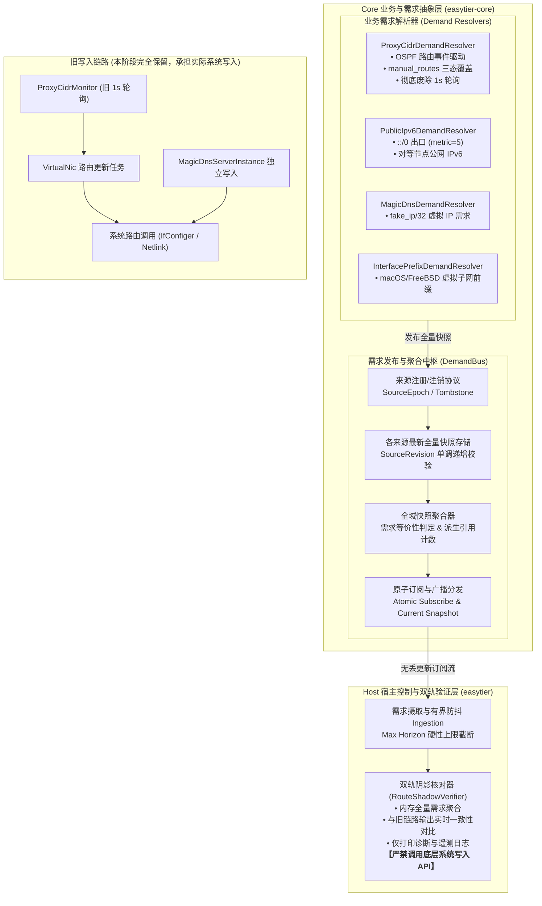
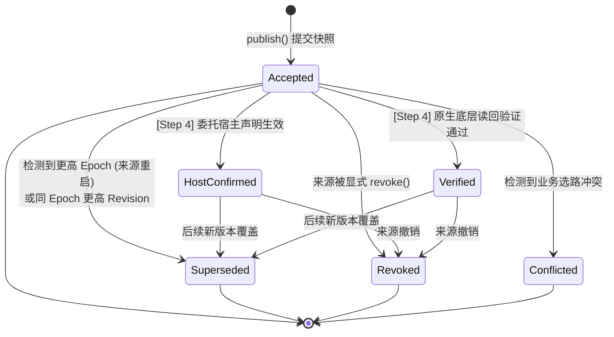

# HostRouteManager 第二步：版本化路由需求接口详细方案

状态：已完成详细方案设计。基于《[实施总纲](host-route-manager-master-plan.md)》第二步要求与第一步冻结的行为契约（[`docs/host-route-manager-step1-audit-and-contract.md`](host-route-manager-step1-audit-and-contract.md)），建立分层清晰、无丢更新窗口、纯事件驱动、版本化且具备双轨阴影验证的路由需求接口体系。  
依据：《[HostRouteManager 实施总纲](host-route-manager-master-plan.md)》第 109–116 行。  
基线代码：本地 `main` 分支 `a017dc13`；涉及 DNS 需求部分核对 `feat/dns-policy` (`2569f35f`)。

---

## 1. 目标与架构定位

### 1.1 第二步核心目标

根据实施总纲，第二步的核心任务是**建立版本化路由需求接口**，将散落在各处的路由生成逻辑收敛为规范的领域模型与快照发布总线：
1. **Core 需求投影与 Host 注册协议**：实现 Core 层的需求解析与 Host 层的来源注册，发布自洽的全量快照，提供无丢更新窗口的原子订阅。
2. **版本化与代际控制**：实现来源 `(SourceEpoch, SourceRevision)` 双单调版本控制、显式撤销语义、墓碑（Tombstone）防旧消息复活、来源重启与初始状态无缝拉取。
3. **业务覆盖策略唯一收敛**：把业务覆盖逻辑（尤其是 `manual_routes` 针对 `None`、`Some([])`、`Some([...])` 的三态语义）收敛在 Core 唯一确定的位置。
4. **彻底废除 1 秒轮询 (`sleep(1s)`)**：由 OSPF 路由变更与配置更新事件直接驱动需求投影，彻底消除历史遗留的 `ProxyCidrMonitor` 轮询时钟。
5. **双轨制安全隔离 (Shadow Run)**：**本阶段严禁启用新的系统写入者**！新需求接口以只读/阴影形式运行，旧写入链路（`ProxyCidrMonitor` 与 `virtual_nic.rs` 等）继续承担实际系统写入，双轨并行比对以验证模型正确性。

### 1.2 Core vs Host 分层架构图

系统严格贯彻 Core（纯业务需求抽象，位于 `easytier-core`）与 Host（宿主系统控制，位于 `easytier`）的分层契约：



---

## 2. 领域模型与类型契约

所有路由需求模型均作为不可变值对象，定义在 `easytier-core/src/route/` 模块下。

### 2.1 来源标识与生命周期版本

```rust
/// 需求来源类型枚举
#[derive(Clone, Copy, Debug, PartialEq, Eq, Hash, Serialize, Deserialize)]
pub enum SourceKind {
    /// 对端子网代理与手工路由覆盖
    ProxyCidr,
    /// 公网 IPv6 默认出口路由 (::/0)
    PublicIpv6Egress,
    /// 公网 IPv6 对等节点路由
    PublicIpv6Peer,
    /// Magic DNS fake IP (/32) 虚拟路由
    MagicDns,
    /// 平台显式虚拟网卡直连子网前缀 (如 macOS/FreeBSD)
    InterfacePrefix,
    /// VPN Portal 客户端动态路由
    VpnPortalClient,
    /// 用户自定义扩展来源
    Custom(u32),
}

/// 全局唯一的来源标识
#[derive(Clone, Copy, Debug, PartialEq, Eq, Hash, Serialize, Deserialize)]
pub struct SourceId {
    pub kind: SourceKind,
    pub instance_id: uuid::Uuid,
}

/// 来源代际 Epoch：每次来源注册或重启时单调递增，代表一次独立的生命周期会话
#[derive(Clone, Copy, Debug, PartialEq, Eq, PartialOrd, Ord, Hash, Serialize, Deserialize, Default)]
pub struct SourceEpoch(pub u64);

/// 来源版本 Revision：同一 Epoch 内每次快照更新严格单调递增
#[derive(Clone, Copy, Debug, PartialEq, Eq, PartialOrd, Ord, Hash, Serialize, Deserialize, Default)]
pub struct SourceRevision(pub u64);

/// 来源活跃状态
#[derive(Clone, Debug, PartialEq, Eq)]
pub enum SourceStatus {
    /// 正常活跃
    Active,
    /// 临时不可达（如通信暂时中断，需求保持 stale 状态不删除）
    Unavailable,
    /// 显式注销（记录注销墓碑，需求从聚合快照中移除）
    Revoked {
        tombstone_revision: SourceRevision,
    },
}
```

### 2.2 路由意图与全量需求快照

```rust
/// 路由业务用途
#[derive(Clone, Copy, Debug, PartialEq, Eq, Hash, Serialize, Deserialize)]
pub enum RoutePurpose {
    PeerProxy,           // 对端广播的子网代理
    ManualOverrideProxy, // 配置覆盖的静态子网代理
    PublicIpv6Default,   // 公网 IPv6 出口默认路由
    PublicIpv6Peer,      // 公网 IPv6 对等节点
    MagicDnsFakeIp,      // Magic DNS 虚拟 IP
    InterfaceSubnet,     // 虚拟网卡链路直连子网
}

/// 出口网关提示
#[derive(Clone, Debug, PartialEq, Eq, Hash, Serialize, Deserialize)]
pub enum EgressHint {
    TunDevice,                         // 默认 EasyTier 虚拟网卡
    NamedInterface(String),            // 指定名称的网卡
    NextHop(std::net::IpAddr),         // 指定下一跳 IP
}

/// 单条路由需求意图 (RouteIntent)
#[derive(Clone, Debug, PartialEq, Eq, Hash, Serialize, Deserialize)]
pub struct RouteIntent {
    /// 目标网络前缀 (IPv4 或 IPv6 CIDR)
    pub destination: cidr::IpCidr,
    /// 业务用途
    pub purpose: RoutePurpose,
    /// 出口目标
    pub egress_hint: EgressHint,
    /// 推荐 Metric / 优先级 (若为 None 则采用平台默认策略)
    pub metric_preference: Option<u32>,
    /// 推荐路由表 (若为 None 则为默认路由表)
    pub table_preference: Option<u32>,
}

/// 单一来源提交的全量需求快照 (RouteDemandsSnapshot)
/// 契约核心：快照是事实，通知是提示。每次提交必须是该来源期望存在的完整集合。
#[derive(Clone, Debug, PartialEq, Eq, Serialize, Deserialize)]
pub struct RouteDemandsSnapshot {
    pub source_id: SourceId,
    pub epoch: SourceEpoch,
    pub revision: SourceRevision,
    /// 该来源持有的全量路由需求项
    pub demands: std::collections::BTreeSet<RouteIntent>,
    /// 生成时间戳
    pub timestamp: std::time::SystemTime,
}
```

### 2.3 需求等价性、合并与派生引用计数

严格遵循第一步第 4.2 节的契约：**两个业务需求能够合并并共享引用的充要条件是具有完全相同的转发语义**。

```rust
/// 聚合后的单条合并路由需求
#[derive(Clone, Debug, PartialEq, Eq)]
pub struct MergedRouteDemand {
    /// 规范化后的路由需求项
    pub intent: RouteIntent,
    /// 拥有此需求的有效来源集合（引用计数严格等于 owners.len()）
    pub owners: std::collections::HashSet<SourceId>,
    /// 是否存在属性不一致的业务冲突（如相同前缀指定了不同出口）
    pub conflict: Option<DemandConflictReason>,
}

/// 业务冲突原因说明
#[derive(Clone, Debug, PartialEq, Eq)]
pub enum DemandConflictReason {
    EgressMismatch { hints: Vec<EgressHint> },
    TableMismatch { tables: Vec<Option<u32>> },
}

/// 全域聚合需求快照 (AggregatedDemandsSnapshot)
#[derive(Clone, Debug, PartialEq, Eq)]
pub struct AggregatedDemandsSnapshot {
    /// 单调递增的总线聚合版本
    pub bus_version: u64,
    /// 各来源最新快照视图
    pub per_source: std::collections::BTreeMap<SourceId, RouteDemandsSnapshot>,
    /// 合并后的需求集合 (以目标 CIDR 和作用域为索引)
    pub merged_demands: std::collections::BTreeMap<cidr::IpCidr, MergedRouteDemand>,
    /// 生成时刻
    pub generated_at: std::time::Instant,
}
```

---

## 3. 业务需求解析器 (Business Demand Resolvers)

业务解析器负责监听系统内具体的业务事件，并向 `DemandBus` 投影出类型化的 `RouteDemandsSnapshot`。

### 3.1 `ProxyCidrDemandResolver` (代理网段业务需求解析器)

#### 3.1.1 业务覆盖策略唯一确立 (Addressing Scope Contract)
在第一步已冻结的契约基础上，消除所有前端或旁路的推导逻辑，将 `manual_routes` 针对 Proxy CIDRs 的三态覆盖规则完全统合在解析器内部：
1. **`manual_routes = None` (自动跟随模式)**：
   - 投影结果 = 对端 Peer 广播的全部合法代理网段 `list_proxy_cidrs()`。
   - 需求属性：`purpose = RoutePurpose::PeerProxy`。
2. **`manual_routes = Some([])` (显式空集，禁用对端代理模式)**：
   - 用户明确要求“不安装任何来自对端的代理路由”。
   - 投影结果 = **空集合 $\emptyset$**。
   - **绝不回退为对端路由，彻底抑制对端代理路由的安装**。
3. **`manual_routes = Some([A, B])` (静态覆盖模式)**：
   - 投影结果 = 严格为用户指定的集合 `[A, B]`。
   - 需求属性：`purpose = RoutePurpose::ManualOverrideProxy`。
   - 对端路由被完全覆盖抑制。

#### 3.1.2 零轮询、纯事件驱动机制 (Eliminating 1-Second Sleep)
旧版 `ProxyCidrMonitor` 在循环中执行 `sleep(1s)` 严重浪费 CPU 且带来最大 1 秒的路由应用延迟。新解析器采用**双事件异步唤醒机制**：
- **通道 1：OSPF 路由变更**：
  在 `easytier-core/src/peers/route/mod.rs` 的 `PeerRoute` trait 中新增 `subscribe_route_updates(&self) -> tokio::sync::watch::Receiver<std::time::Instant>` 接口。当 `PeerRouteServiceImpl::update_peer_info_last_update` 被调用时触发广播。
- **通道 2：配置热重载变更**：
  监听 `CoreRuntimeConfigStore::subscribe_service_runtime_changes()`，当 `manual_routes` 被修改并调用 `replace()` 时触发。

```rust
// 纯事件驱动的反应式循环逻辑
pub async fn run_event_driven_loop(
    mut route_rx: tokio::sync::watch::Receiver<Instant>,
    mut config_rx: tokio::sync::watch::Receiver<u64>,
    peer_manager: Arc<PeerManagerCore>,
    config_store: CoreRuntimeConfigStore,
    bus: Arc<DemandBus>,
    handle: SourceRegistrationHandle,
) {
    let mut last_route_time = *route_rx.borrow_and_update();
    let mut last_config_version = *config_rx.borrow_and_update();

    // 初始立即投影一次
    project_and_publish(&peer_manager, &config_store, &bus, &handle).await;

    loop {
        tokio::select! {
            // OSPF 路由事件唤醒
            res = route_rx.changed() => {
                if res.is_err() { break; }
                let current_time = *route_rx.borrow_and_update();
                if current_time == last_route_time { continue; }
                last_route_time = current_time;
                project_and_publish(&peer_manager, &config_store, &bus, &handle).await;
            }
            // 运行时配置热更新唤醒
            res = config_rx.changed() => {
                if res.is_err() { break; }
                let current_version = *config_rx.borrow_and_update();
                if current_version == last_config_version { continue; }
                last_config_version = current_version;
                project_and_publish(&peer_manager, &config_store, &bus, &handle).await;
            }
        }
    }
}
```

### 3.2 `PublicIpv6DemandResolver` (公网 IPv6 需求解析器)

由 `CorePublicIpv6Runtime` 的租约和对等路由状态驱动：
- **公网出口路由 (`::/0`)**：
  - 条件：本节点成功向 Provider 申请到公网 IPv6 前缀租约（`lease.is_some()`）。
  - 需求生成：
    - `destination: IpCidr::V6("::/0")`
    - `purpose: RoutePurpose::PublicIpv6Default`
    - `egress_hint: EgressHint::TunDevice`
    - `metric_preference: Some(5)`（保证公网 IPv6 流量默认优先走 EasyTier 出口，但不覆盖本地物理 IPv6 直连）
  - 当租约失效时，快照中移除该条目。
- **对等节点公网 IPv6 路由**：
  - 条件：组网内其他 Peer 节点上报的公网 IPv6 地址前缀。
  - 需求生成：
    - `destination: IpCidr::V6(peer_inet)`
    - `purpose: RoutePurpose::PublicIpv6Peer`
    - `egress_hint: EgressHint::TunDevice`
    - `metric_preference: None`

### 3.3 `MagicDnsDemandResolver` (Magic DNS 需求解析器)

由 Magic DNS 服务器状态驱动，彻底消除前端或 GUI 层的硬编码：
- **条件判定**：
  当分配的 Magic DNS 虚拟 IP（如 `7.7.7.7` 或 `100.100.100.101`）不在虚拟网卡分配的子网网段内时（`!tun_inet.contains(&fake_ip)`）。
- **需求生成**：
  - `destination: IpCidr::V4(Ipv4Cidr::new(fake_ip, 32))`
  - `purpose: RoutePurpose::MagicDnsFakeIp`
  - `egress_hint: EgressHint::TunDevice`
  - `metric_preference: if cfg!(windows) { Some(4) } else { None }`
- **退出生命周期**：
  Magic DNS 实例停止时，调用 `revoke_source` 撤销该需求，由协调器完成清理，消除异常退出时的残留漏洞。

### 3.4 `InterfacePrefixDemandResolver` (显式接口前缀需求解析器)

针对 macOS 与 FreeBSD 等不自动派生子网路由的平台特性：
- **触发时机**：TUN 网卡分配 IPv4 / IPv6 地址时（如 `10.144.144.1/24` 或 `fd00::1/64`）。
- **需求生成**：
  - 生成对应的网络前缀需求（如 `10.144.144.0/24` 和 `fd00::/64`）。
  - `purpose: RoutePurpose::InterfaceSubnet`。
  - `egress_hint: EgressHint::TunDevice`。
- **价值**：将隐藏在 `VirtualNic` 中的操作系统级差异显式化为类型化需求，为后续步骤移除 NIC 内部直接写路由打平基础。

---

## 4. 需求总线与订阅协议 (Demand Bus & Atomicity)

`DemandBus` 是 Core 内部管理需求快照与订阅分发的核心枢纽。

### 4.1 来源注册与注销协议

```rust
/// 来源注册成功返回的操作句柄
pub struct SourceRegistrationHandle {
    pub source_id: SourceId,
    pub epoch: SourceEpoch,
    bus: Arc<DemandBusInner>,
}

impl SourceRegistrationHandle {
    /// 提交新版本全量快照，返回可供等待的提交令牌
    pub async fn publish(&self, demands: BTreeSet<RouteIntent>) -> SourceSubmissionToken {
        self.bus.publish_snapshot(self.source_id, self.epoch, demands).await
    }

    /// 显式注销该来源（写入墓碑，移除需求）
    pub async fn revoke(self) -> SourceRevocationRecord {
        self.bus.revoke_source(self.source_id, self.epoch).await
    }
}
```

#### 来源注销与墓碑防复活 (Tombstone Protection)
当来源调用 `revoke()` 时：
1. 总线记录墓碑：`Tombstones.insert(source_id, TombstoneRecord { epoch, final_rev })`；
2. 该来源在 `sources` 表中的状态被置为 `Revoked`，其持有的所有路由需求从全域聚合快照中移除；
3. **防旧消息复活屏障**：若网络或异步任务中存在残留的旧快照提交，总线检查发现 `epoch <= tombstone.epoch` 时，直接拒绝并丢弃，杜绝幽灵路由复活。

### 4.2 原子订阅契约 (Atomic Subscribe & Current Snapshot)

为杜绝“建立订阅”与“读取基线快照”之间的竞态窗口（此窗口会导致订阅者漏掉第一笔更新通知）：

```rust
impl DemandBus {
    /// 原子建立订阅并获取当前聚合快照
    /// 在内部读锁保护下原子完成：保证订阅者收到的第一条通知严格在 initial_snapshot 之后产生
    pub fn subscribe(&self) -> (DemandSubscriber, Arc<AggregatedDemandsSnapshot>) {
        let inner = self.inner.read();
        let receiver = self.broadcast_tx.subscribe();
        let snapshot = self.aggregated_snapshot.load_full();
        
        let subscriber = DemandSubscriber {
            receiver,
            last_seen_version: snapshot.bus_version,
        };
        (subscriber, snapshot)
    }
}
```

### 4.3 有界防抖机制 (Bounded Debounce & Fairness)

在网络震荡或节点高频上线时，对端路由可能在短时间内以 10~20ms 的间隔连续波动。协调器订阅端引入**有界防抖**：
- **防抖窗口 (Debounce Window)**：收到变更通知后等待 50ms。若期间有新通知到达，重置 50ms 窗口。
- **硬性上限 (Max Processing Horizon)**：记录首次收到通知的绝对时间点。一旦流逝超过 200ms，**必须强行截断防抖**，立即读取当前最新快照启动处理！
- **通知溢出自愈 (Lagged Recovery)**：若通知通道收到 `tokio::sync::broadcast::error::RecvError::Lagged`，订阅端无需报错或增量重放，直接调用 `bus.get_current_snapshot()` 重新对齐最新事实。

---

## 5. 提交令牌与收敛等待契约 (Submission Token & Convergence)

为解决配置更新后的异步等待与确定性判定，提供类型化提交令牌与状态机。

### 5.1 类型化提交令牌

```rust
/// 提交令牌：唯一绑定某一次快照提交
#[derive(Clone, Copy, Debug, PartialEq, Eq, Hash, Serialize, Deserialize)]
pub struct SourceSubmissionToken {
    pub source_id: SourceId,
    pub epoch: SourceEpoch,
    pub revision: SourceRevision,
}

/// 收敛完成状态枚举 (严格对齐第一步契约第 8.2 节)
#[derive(Clone, Debug, PartialEq, Eq)]
pub enum ConvergenceStatus {
    /// 需求已被需求总线接收并聚合完成，等待下发
    Accepted,
    /// 委托宿主 (如 Android VpnService) 已确认生效
    HostConfirmed,
    /// 原生后端已调用系统接口并完成读回验证 (FIB 确认)
    Verified,
    /// 本次提交已被同一来源更高版本作废 (生命周期终止)
    Superseded {
        superseded_by: SourceSubmissionToken,
    },
    /// 在等待期间，该来源被显式撤销注销
    Revoked,
    /// 发生无法自愈的业务冲突或选路争抢 (独立状态，绝不混淆为 Superseded)
    Conflicted {
        reason: DemandConflictReason,
    },
    /// 只读降级或持久化异常
    Degraded(String),
    /// No-TUN 模式下显式跳过
    Unsupported,
}

/// 等待收敛查询结果
#[derive(Clone, Debug, PartialEq, Eq)]
pub struct ConvergenceResult {
    pub token: SourceSubmissionToken,
    pub status: ConvergenceStatus,
    pub elapsed: std::time::Duration,
}
```

### 5.2 状态转移与生命周期替代契约

当调用 `wait_convergence(token, timeout)` 时，状态机按以下严密规则判定：



1. **`Superseded` 判定**：
   - 条件 A：总线中该 `SourceId` 的当前 `epoch > token.epoch`（来源已重启/重新注册）；
   - 条件 B：`epoch == token.epoch && current_revision > token.revision`（来源提交了更新的快照）；
   - 满足任一条件立即返回 `Superseded`，释放等待通道。
2. **`Revoked` 判定**：
   - 来源处于 `Revoked` 状态，或墓碑中记录的注销版本包含当前 Token。立即返回 `Revoked`，杜绝悬挂等待至超时。
3. **`Conflicted` 判定**：
   - 独立返回冲突详情，严禁将其误报为被替代或成功。

---

## 6. 代码与模块变更规划 (File & Module Layout)

### 6.1 精确实体文件布局清单

```text
easytier-core/
├── src/
│   ├── route/                         # [NEW] 路由需求抽象与总线模块
│   │   ├── mod.rs                     # 统一导出公共接口与类型
│   │   ├── model.rs                   # SourceId, SourceEpoch, RouteIntent, RoutePurpose 等
│   │   ├── snapshot.rs                # RouteDemandsSnapshot, AggregatedDemandsSnapshot 等
│   │   ├── bus.rs                     # DemandBus, SourceRegistrationHandle, 原子订阅
│   │   ├── token.rs                   # SourceSubmissionToken, ConvergenceStatus
│   │   ├── adapters/                  # 需求解析器适配层
│   │   │   ├── mod.rs
│   │   │   ├── proxy_cidr.rs          # ProxyCidrDemandResolver (OSPF + manual_routes)
│   │   │   ├── public_ipv6.rs         # PublicIpv6DemandResolver (::/0 + peer v6)
│   │   │   ├── magic_dns.rs           # MagicDnsDemandResolver (fake_ip/32)
│   │   │   └── interface_prefix.rs    # InterfacePrefixDemandResolver (虚拟子网前缀)
│   │   └── tests/                     # 单元与契约测试
│   │       ├── mod.rs
│   │       ├── bus_tests.rs           # 订阅竞态、代际更替、撤销墓碑测试
│   │       └── resolver_tests.rs      # manual_routes 三态、零轮询延迟测试
│   ├── peers/
│   │   └── route/
│   │       ├── mod.rs                 # [MODIFIED] PeerRoute trait 增加 subscribe_route_updates
│   │       └── peer_ospf_route.rs     # [MODIFIED] update_peer_info_last_update 触发通知
│   └── instance/
│       └── mod.rs                     # [MODIFIED] 集成 DemandBus 实例
easytier/
└── src/
    └── instance/
        ├── route_shadow.rs            # [NEW] 双轨阴影核对器 (只读比对，不写系统)
        └── tests/
            └── shadow_tests.rs        # [NEW] 双轨比对一致性验证测试
```

### 6.2 模块职责与依赖约束
- `easytier-core::route` 绝不依赖任何系统平台库（如 netlink、win32 api 等），保持纯粹的跨平台与 WASI 兼容。
- `DemandBus` 在 Core 实例创建时初始化，作为只读需求提供者供上层查询。
- 依赖项：利用已有的 `tokio`, `cidr`, `uuid`, `arc-swap`, `serde`，无需引入外部重量级依赖。

---

## 7. 测试与验证方案 (Test Plan)

针对实施总纲第二步的全部验收要求，设计 8 类完备的测试用例：

| 序号 | 测试用例名称 | 测试目标与验证步骤 | 期望结果 (Pass Criteria) |
| :--- | :--- | :--- | :--- |
| **T1** | **原子订阅与高并发竞态测试**<br>`test_bus_atomic_subscription_race` | 5 个并发线程以随机间隔向 `DemandBus` 提交快照。与此同时，10 个订阅者并发建立订阅。 | 每一个订阅者获取的 `(initial_snapshot, stream)` 必须无缝衔接；版本号单调递增，绝不出现初始快照遗漏通知或通知乱序倒退。 |
| **T2** | **陈旧版本与乱序提交丢弃测试**<br>`test_bus_stale_revision_rejection` | 来源先后提交 Revision 1、Revision 3。然后模拟乱序网络延迟，再次提交 Revision 2。 | Revision 2 必须被总线幂等丢弃；总线中该来源的最新快照保持为 Revision 3；版本未发生回退。 |
| **T3** | **来源重启与代际更替测试**<br>`test_source_restart_epoch_increment` | 来源以 Epoch 1 提交 Revision 1，异步调用 `wait_convergence` 等待。模拟来源重启，以 Epoch 2 注册并提交 Revision 1。 | 原 Epoch 1 的等待令牌立即返回 `Superseded`，不发生死锁或超时；总线快照无缝更新为 Epoch 2 内容。 |
| **T4** | **显式撤销与墓碑防复活测试**<br>`test_source_revocation_and_tombstone` | 来源提交快照后调用 `revoke()`。随后人为注入滞后的旧快照提交。 | 等待令牌立即返回 `Revoked`；聚合快照中该来源需求立即清空；后续旧快照被墓碑机制安全拦截，绝不发生“幽灵复活”。 |
| **T5** | **`manual_routes` 三态覆盖与多来源独立性测试**<br>`test_manual_routes_three_state_isolation` | 同一实例同时启用 Proxy CIDR、Magic DNS (`7.7.7.7`) 和 Public IPv6 (`::/0`)。分别设置：<br>1. `None`<br>2. `Some([])`<br>3. `Some([192.168.1.0/24])`。 | 1. 自动跟随对端路由；<br>2. 代理需求严格为 `[]`，对端代理被完全抑制；<br>3. 仅有 192.168.1.0/24；<br>**三种情况下，Magic DNS 与 IPv6 需求均不受任何干扰，始终独立存在**。 |
| **T6** | **零轮询、事件驱动响应延迟测试**<br>`test_event_driven_latency_under_10ms` | 启动 `ProxyCidrDemandResolver`。向 `PeerRoute` 注入对端路由更新，或向 config store 更新配置。记录时间差。 | 解析器在 **10 毫秒以内**完成需求快照更新并发布到总线，端到端耗时远低于历史的 1000ms 轮询时钟。 |
| **T7** | **双轨数据阴影比对测试**<br>`test_shadow_dual_track_equivalence` | 同时运行旧版 `ProxyCidrMonitor` 和新版 `ProxyCidrDemandResolver`。注入动态 peer 增删网络拓扑。 | 新解析器输出的需求集合与旧 monitor 计算出的路由目标完全等价，证明新投影模型的无缝替代性。 |
| **T8** | **高频事件有界防抖与抗饥饿测试**<br>`test_bounded_debounce_max_horizon` | 以 10ms 间隔连续发送 30 次 OSPF 路由抖动事件（总时长 300ms）。 | 防抖机制在达到 200ms 的硬性上限 (Max Horizon) 时强制截断并分发快照，不会被高频事件无限顺延或导致 CPU 饥饿。 |

---

## 8. 准入与进入第三步的验收标准

在完成第二步实施后，必须满足以下标准方可进入第三步（纯规划器和归属状态机）：

- [ ] **接口与模型就绪**：`RouteDemandsSnapshot`、`SourceId`、`SourceEpoch`、`SourceRevision` 等核心模型在 `easytier-core` 中编译通过并通过单元测试。
- [ ] **业务策略收敛唯一**：`manual_routes` 的三态覆盖逻辑已全部迁移至 `ProxyCidrDemandResolver`，移动端与前端已对接或对齐该抽象。
- [ ] **彻底消除轮询**：`ProxyCidrDemandResolver` 实现了由 OSPF 路由与配置变更纯事件驱动，零 `sleep(1s)` 依赖。
- [ ] **无新系统写入者**：第二步未引入任何向宿主操作系统路由表写入的操作，旧链路保持原样正常工作。
- [ ] **测试全绿**：第七节规划的 8 项测试全部编写完毕并稳定通过。
